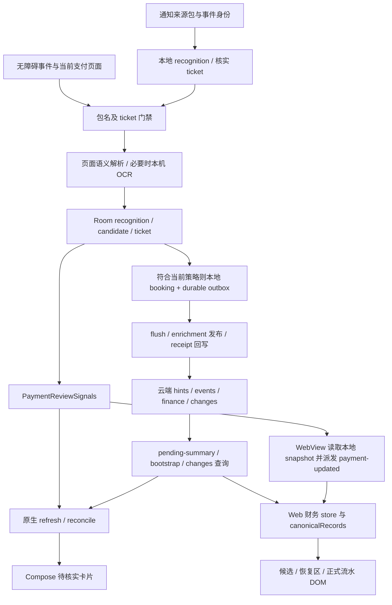

# Aeris Android 无障碍记账显示异常：独立根因调查

调查日期：2026-10-16，Asia/Hong_Kong（UTC+08:00）。本轮仅调查、只读设备诊断及报告，不修复、不构建、不安装、不发布。所有源码行号按本轮固定工作区实际文件计数；Git 历史版本另行标注。

**调查结论：PARTIALLY CONFIRMED。** 已用实际 Web 源码和合成数据复现两条状态一致性路径：本地金额正确时，待核实列表仍投影云端旧金额；财务同步期间的更新通知被合并，结束时没有执行必需的补拉，手动刷新后恢复。它们证明“识别已经产生数据，界面仍可能显示旧状态”在当前代码中成立。尚未取得用户当时那笔交易的同一事件、数据库、网络响应和画面时间线，不能把这两条机制直接认定为历史事件的唯一根因，也没有证明“同一笔微信交易被解析成支付宝”。

**业务代码修改：NONE。** 本轮唯一新增的待审阅项目文件是本报告；一次性诊断脚本、合成结果与脱敏元数据置于已有忽略目录。调查完成后停止，等待所有者审核；本报告不启动第二阶段，不宣告 Task 26 完成。

## 1. 当前环境与版本基线

| 项目 | 本轮实际核对结果 | 证据边界 |
| --- | --- | --- |
| 工作区 | `%USERPROFILE%\Desktop\编程\thewyj.uk` | 已读取根 AGENTS.md、WINDOWS_WORKSPACE.md、WORKSPACE_MIGRATION_REPORT.md、PAUSED_DEVELOPMENT_HANDOFF.md |
| 分支 / HEAD | `codex/android-accessibility-accounting-hotfix` / `e2febc6d9a33997bd9dc4cb042ecff216d31fde4` | 当前源码包含原有 WIP，不等同手机安装内容 |
| 本地 origin/main 引用 | `74eadf589b0a6ffe1e5ab7a9564115891c4ef2dc` | 只读取已有引用，未 fetch，不能宣称本轮核对过 GitHub 最新分支或 CI |
| 进入时改动 | 14 个 tracked 修改，11 个实际 untracked 文件（Git 短状态聚合为 9 条路径） | SHA-256 初始清单覆盖 817 个 tracked 文件及 11 个 untracked 文件 |
| ADB | 1.0.41，platform-tools 37.0.0；指定三星序列连接成功 | 报告不输出完整设备序列号 |
| 设备 | Samsung SM-S9360 / Android 16 / API 36 | `getprop` 当前读取 |
| 正式包 | `uk.thewyj.app`，`1.3.37` / code `50`，minSdk 30 / targetSdk 36 | `dumpsys package` 与拉取的已安装 APK 的 aapt 结果一致 |
| 构建类型 | 与正式 Release B 发布元数据匹配的非 debuggable 包；未安装 `uk.thewyj.app.debug` | 包 flags 无 DEBUGGABLE；`run-as uk.thewyj.app id` 被系统以 not debuggable 拒绝 |
| APK 身份 | 48,124,983 bytes；SHA-256 `9a4fad7f01c1dd1013efbcabd3931ea6c698b52dc2d2ce10cd18745ad7d7f55a` | 从手机只读拉取，匹配 `android/release-metadata.json:2–12`；没有重新下载或修改 R2/APK |
| 安装更新时间 | `2026-10-10 15:24:26`（设备输出原值） | 不把时间推断为某次问题发生时间 |
| 当前进程 / 前台 | Aeris PID 24927；前台为 Samsung Launcher，Aeris 在后台 | 只观察当前状态，没有进行冷启动/切换操作 |
| WebView | `com.google.android.webview` / `155.0.8059.43` | 当前 `dumpsys webviewupdate` |
| 无障碍 | 系统总开关为 1；正式 Aeris 服务在 enabled 和 bound 中 | 开启及绑定已证实；不等于本轮验证了支付解析或自动记账成功 |
| Room | 当前工作区 schema 10；`74eadf5` 原生源码 schema 9 | `NotificationDatabase.kt:27–50`；没有读取手机实际 DB 或执行迁移，运行时 schema 为 NOT TESTED |

手机 APK 哈希核对的是已安装制品身份，不是一次可重现构建或二进制反编译到源码的证明。`d8ca1e3` 是发布 1.3.37 元数据的提交；已用 Git 对比其与 `74eadf5` 的 `android/app/src/main/java`，无差异。当前 Hotfix 已有解析、安全门禁和 schema 修改，这些未安装；本报告不会用它们推断手机已运行新逻辑。

关键未变化的原生文件另作 Git blob 比对：`MainActivity.kt`、`core/web/ThewyjWebView.kt`、`task21/payment/PaymentReviewSignals.kt`、`CanonicalPendingCache.kt`、`PendingReconciliationPolicy.kt`、`task21/store/PaymentDao.kt` 均与 `74eadf5` 相同。`PaymentVerificationState.kt` 与历史版本仅提示文字不同；Screen、Center 的显示/投影相关代码也逐段对照过，但文件整体存在原 Hotfix 差异。

本轮 10:33:46 HKT 对正式域名仅执行无认证的公开静态 GET。`index.html`、`app.js`、`sw.js`、三个 finance 模块和 `keyed-list.js` 均 HTTP 200，响应字节与当前工作区一致。这证明本次审查的 Web 代码可由正式域名取得；没有读取手机 WebView 的实际缓存实例，也没有核验云端函数部署提交。

| 已核对的公开脚本 | SHA-256 |
| --- | --- |
| `js/finance/app.js` | `54e7f8d5fec6c13567fdc0b275df50cf7d41076838608f24a57838a103c4e983` |
| `js/finance/candidates.js` | `b8075e13a761f588629b1f5ec23fb59b0ecf5491c7605d4e84746027ab6122c4` |
| `js/finance/notification-ledger.js` | `f44fac15ad67543308ad30f5cd31d7050c4e8d9dce3bf7f472a4b08de6b7203c` |

## 2. Task 26 及暂停 Hotfix 的隔离

本轮发现独立工作树 `%USERPROFILE%\.codex\worktrees\task26-wrong-review\thewyj.uk`，分支 `codex/task26-wrong-review`。初次观察 HEAD 为 `69394d9d22c78536713623173112730ac7e60b9d`，存在自己的未提交文件；10:37:40 HKT 的只读检查已变为 `d305ebbdb0495cea6422be8a45006222cf5e1f91`，说明不能把该并行工作区假定为静止。

应用聊天列表同时显示“整合 Task 26 错题复习”为 active，历史“完成 Task 26 发布并修复 Android”为 idle；未向这些聊天发送消息、打断或改变状态。根工作区保留原暂停 Hotfix，不切分支，不创建调查分支，不占用上述工作树。

交接文档对历史 Task 26 记载 `CLOSED_WITH_OWNER_WAIVER`；用户本轮明确指出当前 Task 26 修复仍未完成。这里分别记录历史标签与当前并行工作，不以历史标签认定当前修复完成，不把任何 WAIVED 门禁改为 PASS。

进入时 tracked 修改为 `.github/workflows/ci.yml`、`.gitignore`、README.md、package.json、android/gradle.properties、docs/ANDROID_POST_TASK26_HOTFIX.md，以及 Android 的 PaymentAccessibilityGateway、PaymentAccessibilityStatus、PaymentStatusStateMachine、ThewyjPaymentAccessibilityService、PaymentVerificationScreen、PaymentVerificationState、ThewyjApp 和 PaymentAccessibilityServiceGateTest。11 个 untracked 文件的逐文件 hash 保存在初始清单；所有这些文件原样保留。

隔离措施和结果：

- 除报告及忽略证据附件外，没有写入项目路径；Task 26 工作树仅运行只读 Git 查询。
- 没有 checkout、reset、clean、stash、pull、commit、push、merge、release dispatch、Wrangler 命令或远端迁移。
- 没有 Android/Node 项目构建、依赖安装、CI 重跑、服务器启动；Node VM 诊断在工作区外执行，传输和 DOM 使用桩，正式网络调用为 0。
- 未读取根 `访问口令.txt`，未读取 Cookie、token、签名库、私人通知正文或真实交易明细。
- 不查询登录后的 Production 财务 API。特别是源码 `functions/_lib/task21-hints.mjs:659–667` 的 `notificationPendingSummary()` 即使由 GET 调用也执行历史候选/alias reconciliation，因此不能仅凭 HTTP 方法将刷新认定为只读。
- `MainActivity.syncPayments()`（`android/app/src/main/java/uk/thewyj/app/MainActivity.kt:42–61`）在启动/恢复时 flush 队列并同步 hints；为避免处理未知真实待同步账目，本轮没有主动拉起、force-stop、刷新正式 App 或切换其网络。

10:37:40 HKT 中途完整复核 828 个原文件，内容变化 0；最终复核结果见第 13 节。Task 26 自身的提交变化属于另一任务，本调查没有复写或回退它。

## 3. 实际技术栈与完整数据链路

这是 ComponentActivity + Compose 原生外壳、原生待核实弹层、WebView 中原生 JS 财务页、Room、本地持久化队列和 Pages/D1 API 的组合。相关支付列表没有使用 Fragment 或 LiveData。AppViewModel 的 StateFlow 管理会话、导航和打开待核实页面的 ID；交易列表由独立 `PaymentVerificationState` 的 Compose mutableState 管理，不是同一条数据库 Flow。

以下路径均相对于固定根目录，不是旧日期源码副本。

| 层次 | 数据生成、保存、状态与通知责任 | 实际函数及行号 |
| --- | --- | --- |
| 事件与包名 | 事件 packageName / 当前窗口包名决定来源；只对有效 ticket 扫描相应页面 | `android/app/src/main/java/uk/thewyj/app/task21/payment/ThewyjPaymentAccessibilityService.kt`，`onAccessibilityEvent():68–82`，`readPage` 所在扫描段 `170–188`，`apply():203–210` |
| 页面解析 | extract 从 snapshot 提取 amount、direction、来源包；读取无结果不等于服务未开启；OCR 走同一 enrichment 提交通道 | `android/app/src/main/java/uk/thewyj/app/task21/payment/PaymentPageSemantics.kt`，`extract():21–66`；Service `screenshot():217–245` |
| ticket 一致性 | enrich 检查有效期和来源包名；金额冲突拒绝，不把支付宝页面补给微信 ticket | `android/app/src/main/java/uk/thewyj/app/task21/payment/PaymentTicketEngine.kt`，`enrich():119–152` |
| Room 写入 | Applied 后依次保存 ticket、recognition 金额/状态、candidate、完成 ticket，再判断 autoBook；此 enrichment 整段不是单个 Room transaction | `android/app/src/main/java/uk/thewyj/app/task21/payment/PaymentRecognitionCoordinator.kt`，`onAccessibilityEnrichment():200–290` |
| 本地记账 | 当前 Hotfix 的资金完成证据门禁与正式 50 不同；真正 booking 时 booking、candidate、recognition、归档财务关联在 transaction 内保存 | Coordinator `autoBook():307–345`；`android/app/src/main/java/uk/thewyj/app/task21/store/PaymentRecognitionStore.kt`，`bookLocally():72–84` |
| UI 失效通知 | Room 更新完成后先 publish，再异步发布 enrichment；异步结束 finally 再 publish。事件本身不携带金额 | `android/app/src/main/java/uk/thewyj/app/task21/payment/AndroidPaymentRecognitionHook.kt`，`onAccessibilityEnrichment():155–181`；`PaymentReviewSignals.kt:5–8` |
| 同步上传 | 恢复本地 outbox 后发布结构化 source_package / amount / direction / channel；POST 成功的确切 receipt 决定终态 | `android/app/src/main/java/uk/thewyj/app/task21/payment/LocalPaymentLedger.kt`，`recover():11–110`；`PaymentHintSync.kt`，`publishEnrichment():144–215`；`android/app/src/main/java/uk/thewyj/app/task21/NotificationIngestClient.kt`，`hintPayload():76–121` |
| receipt 回写 | 有 transaction_id 才可 acknowledge 本地账目，回写后移除 durable request；Hook 再通知 UI | `android/app/src/main/java/uk/thewyj/app/task21/NotificationCaptureCoordinator.kt`，`flushDetailed()` 的 `439–471`；Hook `onFinanceOutcome():193–233` |
| 云端保存 | 相同事件丰富原 hint，原有金额不被新值覆盖；新自动流水创建 transaction 及 transaction change feed | `functions/_lib/task21-hints.mjs`，`upsertNotificationHints():424–459,533–581`；`functions/_lib/task21-service.mjs`，`createAutomaticFinanceTransaction():141–224`（本轮只审查源码） |
| 云端读模型 | pending-summary 统一返回 pending 身份、source_package、app_label、金额、direction；流水查询另返回 event aliases | `functions/_lib/task21-hints.mjs`，`notificationPendingSummary():659–797`；`functions/_lib/task16-service.mjs`，`financeBootstrap():636–653`、`financeChanges():656–673`、`listFinanceTransactions():693–708` |
| 原生数据源 | refresh 先读 canonical cache/Room；reconcile 执行同步和完整 summary；完整 summary 的字段优先于匹配的本地字段 | `android/app/src/main/java/uk/thewyj/app/ui/PaymentVerificationState.kt`，`refresh():45–84`、`reconcile():88–128`；`android/app/src/main/java/uk/thewyj/app/task21/payment/PaymentVerificationCenter.kt`，`reconcile():160–188`、`buildItems():196–304` |
| WebView 桥 | 前台、onPageFinished、PaymentReviewSignals 都可重新读取本地 snapshot；evaluateJavascript 设置全局快照并派发 DOM 事件 | `android/app/src/main/java/uk/thewyj/app/core/web/ThewyjWebView.kt`，`ThewyjWebView():124–157`、`publishPaymentLedger():193–207`、`onPageFinished():334–336`；`LocalPaymentLedger.kt`，`snapshot():114–146` |
| Web 页面状态 | store 按 account 缓存在 localStorage；payment-updated 合并本地 booking 并请求同步。候选维护独立 canonicalRecords | `js/finance/app.js`，`ensureStore():365–380`、`performSync():712–747`、`syncNow():749–789`、监听 `1132–1138`；`js/finance/candidates.js`，`loadCandidates():345–396`、`show():566–585` |
| 渲染 | Web 用实体 ID 的 stable key 与完整记录签名；原生卡片直接读取 item.appLabel 和 item.amountMinor | `js/finance/app.js`，`renderTransactions():473–514`；`js/finance/candidates.js`，`render():211–278`；`js/core/keyed-list.js`，`reconcileKeyedRows():8–51`；`PaymentVerificationScreen.kt:151–182,310–336` |

## 4. 根因与证据等级

证据等级限定到每个命题：CONFIRMED 表示本轮直接代码证据或受控复现；PROBABLE 表示机制充分但未还原现场；HYPOTHESIS 仍需验证；RULED OUT 仅排除所述具体路径，不代表排除全部识别故障。

### RC-1：本地金额已正确更新，canonical 投影仍保留云端旧值

**CONFIRMED（投影行为）；PROBABLE（对应用户金额显示异常）。**

`js/finance/notification-ledger.js` 的 `mergeLocalNotificationReviews():39–42` 完全不使用 snapshot 和 accountId，只返回远端 pending records。`localNotificationRecovery():45–51` 又排除已经出现在远端 canonical event_ids 中的本地记录。因此，同一事件在云端仍为 amount=null，而本机已经提取金额时，canonical 卡片继续“金额待补”，恢复区也没有这笔本地金额的卡片。这是现有“云端决定 pending 身份集合”设计的实际投影取舍，并非证明金额解析失败。

原生也存在同类行为：`PaymentVerificationCenter.buildItems():284–302` 找到相同 event aliases 的本地 item 后，仍通过 `.copy(amountMinor = record.amountMinor, direction = ..., appLabel = record.appLabel...)` 将字段替换为云端记录；`PaymentVerificationState.refresh():50–74` 可使用未过期校验的 canonical cache。`PaymentVerificationScreen.amountLine():327–329` 只依据最终 item 的空金额显示“暂未识别到金额”。该文案不能单独证明 Room 没有金额。

安全复现 P1 使用真实 `mergeLocalNotificationReviews()` 和 `localNotificationRecovery()`：远端与本地的合成 event_id 相同，远端金额未知，本地金额已知；结果 canonical 金额仍未知、recovery 数量 0。P2 将相同事件的新 summary 送入真实 `canonicalPendingCandidates()` / `candidatePresentation()` 后，金额未知标志变为 false。没有改写函数算法，只有 VM 模块装载适配。

边界：Web 候选在 payment-updated 后会 `reload({ force: true })`（`candidates.js:576–579`）。网络和第二次通知正常时应收敛，不能把 RC-1 描述为所有场景都会永久不刷新。Native Hook 的首次信号先于异步发布（`AndroidPaymentRecognitionHook.kt:155–175`），足以产生“第一次查询早于云端金额更新”的时间窗口；网络失败、旧 cache 或后续触发缺失会延长它。用户历史现场是否处于这个窗口未证实。

### RC-2：财务同步进行中收到更新，补拉被 pending.length 门禁丢弃

**CONFIRMED（实际控制器的确定性合成复现）；PROBABLE（用户历史流水未刷新的原因）。**

`js/finance/app.js` 的 `syncNow():752–754` 在已有 syncPromise 时只设置 `syncAgainRequested=true` 并返回旧 Promise。`finally():779–786` 却要求 `store.pending.length > 0` 才再次同步。Android 新账目/云端更新不一定产生 Web 的 pending operation；当更新发生在旧的最后一次 changes 查询已取快照、但响应尚未结束时，该通知加入旧查询，后续补拉因 Web pending=0 被丢弃。`renderAll()` 会运行，但它仍渲染旧 store。

此外，`mergeLocalNotificationLedger():19–22` 对 sync_state=synced、却没有现存 provisional row 的本地 receipt 不插入流水，这是防止历史 receipt 复活已删除流水的保护。它意味着不能依赖该 snapshot 无条件补齐新云端流水；仍需要 RC-2 所丢失的真正云端查询。不能为修复刷新而去掉这项保护。

P3 直接执行真实 `createFinanceController()` 的 show、payment-updated 监听及 syncNow，桩传输控制最后一次旧响应。自动周期结束后 bootstrap=1、changes=2、pending=0、新 transaction 不在 store；随后显式 syncNow，bootstrap=2、changes=4，新 transaction 出现。这个复现没有向正式 API 发出请求。它适用于正式流水和统计，不能单独解释候选卡片的渠道文字。

### RC-3：原生倒计时显示读取一次性 remainingMs 快照

**CONFIRMED（直接源码证据，未做真机倒计时复现）。**

`PaymentVerificationCenter.buildItems():235–259` 在构造 Item 时计算 ticketActive 和 remainingMs。`PaymentVerificationScreen.kt:77–82` 每秒只增加 tick；`193–195` 显示的仍为同一个 item.remainingMs，没有从 expiresAt 重新计算，也没有每 tick refresh。没有新查询替换 item 时，重组不会减少这个常量，ticketActive 也可能仍是旧值。此问题会误导用户对“核实仍在进行”的判断，但不能解释微信文字变成支付宝。

### RC-4：原生缓存与两类异步刷新缺少统一的新旧顺序

**CONFIRMED（无 TTL 及比较规则的代码事实）；PROBABLE（旧结果覆盖新状态的风险）；未做原生调度复现。**

`CanonicalPendingCache.read():18–28` 校验记录数，不校验 observed_at 的年龄；`save():31–35` 只比较 epoch 和完整性；epoch 只在 `terminalize():39–47` 前进。普通 summary 的先后写入不提升 epoch，因此两个相同 epoch 的拉取可以按返回顺序保存，旧响应仍可能覆盖较新 summary。

`PaymentVerificationState.refresh():45–75` 用 refreshGeneration 防不同 refresh 乱序，`reconcile():98–110` 用 canonicalMutation 防本屏的 confirm/ignore 并发；二者不是共同的请求序号。已拿到旧 snapshot 的 refresh 若比一次新 reconcile 晚结束，其结果仍可能通过各自门禁。`MainActivity.syncPayments():50–61` 的线程和原生页面 reconcile 也不是同一把跨组件锁。需要后续用可控延迟的 native fixture 验证具体交错，不能声称已经在三星上发生。

### RC-5：信号可能丢失，但不存在“整个项目完全没有刷新通知”

**HYPOTHESIS（特定信号丢失）；RULED OUT（完全没有通知链这一笼统解释）。**

`PaymentReviewSignals.kt:5–8` 使用无 replay 的 MutableSharedFlow，extraBufferCapacity=1，忽略 tryEmit 返回值。无订阅者不会补发旧信号；慢订阅者缓冲满时 tryEmit 也可能失败。原生订阅 `PaymentVerificationScreen.kt:71` 在同一 collect 中顺序执行 refresh/reconcile，可能等待网络。

但不能据此直接认定根因：WebView 用 collectLatest（`ThewyjWebView.kt:154–157`），并在恢复和加载完成重新 snapshot（`124–127,148–152`）；原生有 resumeEpoch 和手动刷新（`PaymentVerificationScreen.kt:64–76,125`）。这些兜底已存在。源码同时确认 Room 查询主要返回一次性 List，`PaymentDao.kt:17–18,109–116`；仅 pending count 提供 Flow（`136–138`），本轮全量源码搜索未见 UI 订阅它。不能把 Room 的写入自动等同为交易卡片更新。

### RC-6：真实微信交易被当成支付宝，尚无同一身份的证据

**HYPOTHESIS（旧支付宝卡片暂留而新微信记录尚未进入页面）；INCONCLUSIVE（用户那次渠道显示异常的具体原因）。**

当前缺少当时的 canonical_id/event aliases、截图对应页面、source_package、app_label 与两个连续 response。不能确定用户看到的是旧的另一张卡、同一张卡的错误字段、原生弹层，还是正式流水的 merchant 文本。RC-1/RC-2 说明旧视图可以保留，但不能证明同一笔交易被换了渠道。

## 5. A–F 故障分类结论

| 分类 | 本轮判定 | 依据及限制 |
| --- | --- | --- |
| A 数据没有更新 | 历史现场未确定；合成 P1 中排除 | P1 明确输入本地已知金额；没有读取用户实际 Room，不能反推那笔真实记录 |
| B 已更新但 UI 未收到通知 | HYPOTHESIS | RC-5 的 SharedFlow 缓冲/生命周期风险；已有多处 publish 与恢复兜底，不能认定一律漏订阅 |
| C 已收到通知但没有正确渲染 | 状态投影问题 CONFIRMED；DOM/Compose 绘制错误未证实 | P1 保留旧投影，P3 事件监听运行后 store 仍旧；拿到新金额的 P2 正确。没有证明渲染器把一个正确微信 item 画成支付宝 |
| D 本地正确，云端或缓存仍旧 | 投影机制 CONFIRMED；历史触发 PROBABLE | RC-1、RC-4；不声称本轮读取了真实云端交易数据或验证了 D1 副本延迟 |
| E 请求竞态/旧状态覆盖 | Web 补拉丢失 CONFIRMED；Native 覆盖 PROBABLE | P3 是通知与旧请求交错，实际问题是没有再拉，不是 Web 并行响应直接互盖；Native 两类 generation 尚待调度复现 |
| F 其他 | 倒计时快照 CONFIRMED；识别错误无证据 | RC-3；服务 enabled/bound 与单笔金额可提取不是同一个状态 |

## 6. 微信/支付宝显示的独立链路

1. 通知来源解析：`SourceParsers.kt` 的 `WeChatPaymentParser.matches():6–11` 要求 `com.tencent.mm`，channel=wechat；`AlipayPaymentParser.matches():125–130` 要求 `com.eg.android.AlipayGphone`，channel=alipay。无障碍 enrichment 保留 snapshot.sourcePackage（`PaymentPageSemantics.extract():55–65`），ticket 包名校验见 `PaymentTicketEngine.enrich():127–128`。
2. 本地保存：`PaymentEntities.kt:24–35` 保存 recognition 的 sourcePackage、paymentChannel、金额和方向；candidate channel 来自原 ticket（`PaymentRecognitionCoordinator.kt:260–270`）。`PaymentAppLabels.resolve():34–45` 优先系统 app label，再用 `KNOWN:15–18` 的微信/支付宝映射；不能把系统 label 的正确性视为本轮已测。
3. 上传：`NotificationIngestClient.hintPayload():107–115` 将 source_package、payment_channel、app_label、amount_minor 分别保存为结构化字段，彼此不是同一个字段。云端 hint upsert 读取各自字段（`task21-hints.mjs:446–450`）；strong identity 查询还限定 user、source_package、payment_channel（`108–125`）。
4. 云端 pending 展示源：`notificationPendingSummary():694–698,776–786` 返回 source_package 与 app_label。hint 的非空 app_label 优先，空时按包名回退；云端原始 app_label 错误尚未查实。
5. Web 待核实卡片：`canonicalPendingCandidates():64–83` 用该 summary 生成 evidence；`sourceLabel():86–94` 优先根据包名映射标签。合成 P2 特意给 com.tencent.mm 一个错误 app_label，输出仍为微信。因此“正确 com.tencent.mm 被此 Web 映射函数硬编码显示成支付宝”在该路径 **RULED OUT**。不能据此排除上游给错 package 或看错记录身份。
6. Native 卡片：`PaymentVerificationCenter.buildItems():289–295` 优先 server app_label；`PaymentVerificationScreen.kt:165` 直接 Text(item.appLabel)。这条路径没有像 Web 一样先以已知 package 覆盖异常 server label；属于待验证的数据一致性风险，未证明实际存在错误 label。
7. 正式流水：`normalizeTransaction():95–125` 并不保存渠道展示字段；`renderTransactions():505–510` 的标题取 merchant/counterparty，来源提示为 Android 自动识别。看到标题“支付宝”并不能直接判定 payment_channel=alipay。需要先确定用户看到的区块。
8. Web 列表 key：候选为 kind:id（`candidates.js:72,222–224`），流水为 transaction.id（`app.js:501–503`），signature 包含整条对象；`reconcileKeyedRows():31–48` 在签名变更时替换行。没有发现按数组位置复用渠道文字的代码证据。Native 使用 forEachIndexed 而无显式 key（`PaymentVerificationScreen.kt:151–177`），但渠道 Text 直接读取当前 item，没有独立 remember(label)；仅缺 key 不足以证明串行显示。后续可补稳定身份来降低卡片内部状态随排序迁移的风险。

## 7. 金额、核实标识、去重与终态

金额已提取、方向已确定、交易可记账、已本地记账、云端已确认、UI 已刷新是六个不同事件。服务开启只代表采集能力可用。`candidatePresentation():45–60` 与 `PaymentVerificationScreen.stateLabel():310–324` 都可能因为方向、金额或 server authority 不同而显示待核实；需要记录同一个 event 的各字段，不能只记录一条“服务已开”。

Applied enrichment 中金额和 recognition 状态一起 copy 保存（Coordinator `249–256`），candidate 另存（`259–284`）；首次 UI publish 位于 Hook 返回 Applied 后（`155–159`）。因此不能说必定在金额保存前通知 UI。跨线程读可能观察到多表写入中间态，因为整个 enrichment 不是统一 transaction；本轮未复现，列为 **HYPOTHESIS**。真正 `bookLocally()` 已经使用 Room transaction，不能把该原子保存误报为缺失。

本地核实/去重标识遵循 account + recognition/event 与精确归档 aliases。`PaymentVerificationCenter.buildItems():204–230,283–304` 的 classify/distinctBy 可以决定卡片进入 canonical、recovery 或隐藏；`localNotificationRecovery():47–51` 也会按 aliases 隐藏已观察/已本地记账的重复项。其用途是避免双列计数，副作用是 RC-1 中旧 canonical 字段挡住本机已知金额；没有发现仅按同金额把微信与支付宝合并的该展示代码。

云端 hint 丰富采用 COALESCE，仅补空值且终态不复活（`task21-hints.mjs:533–581`）。`createAutomaticFinanceTransaction():142–164` 按账户/event 或 provider reference+direction 重用流水，而不是按列表索引；`209–224` 已发出 transaction change。旧“只发 raw_event 导致客户端忽略”的历史问题在当前审查代码中已有处理，不把注释里的旧问题当作现行已复现根因。

原生金额未知文案直接来自最终投影（Screen `327–329`），与识别数据库的真实金额可能不同；倒计时也来自一次性 Item。后续验收必须同时比较 recognition/candidate、canonical summary、page item 和 rendered identity。

## 8. 生命周期、缓存与网络顺序

| 情况 | 已存在机制 | 仍需注意的边界 |
| --- | --- | --- |
| 冷启动/前后台恢复 | `MainActivity.onStart():42–58` 同步；WebView `effectiveActive:72–75,148–152` 恢复并发 snapshot；Native Screen `64–71` refresh + reconcile | 多条异步链不是同一事务；onResume 不保证云端 POST 已完成 |
| Web 财务进入/重进 | `js/finance/app.js` 的 show `1141–1154` 先渲染本地 store 再 sync；候选 show `566–585` reload | 首帧可以合法为旧 cache；应清楚表明更新中/上次核对时间 |
| 页面保持打开 | Native 信号订阅与有限补拉；Web payment-updated 强制候选 reload，财务 syncNow | Web 财务无持续订阅云端变化的流；RC-2 可丢补拉。不能用全局 backend 健康轮询代替财务刷新 |
| 原生补拉窗口 | `PendingReconciliationPolicy.kt:20–38` 延迟 1.5/3/6/12 秒，共 22.5 秒的等待量；`PaymentVerificationState.catchUpReconciliation():264–276` | 网络请求耗时另计，并非严格 22.5 秒完成；相同 pendingKey 不变时，尝试用尽不会仅因时间经过自动重启 |
| Android Web 活动信号 | `ThewyjWebView.syncPageActivity():210–218` 发 thewyj:webview-active | 与浏览器 visibilitychange 是不同事件；`app.js:7224–7233` 主要刷新 dashboard/backend/消息，不能假定直接更新财务流水 |
| 断网恢复 | MainActivity network callback `23–27`；Web finance online 监听 `1132–1134`；native cache fallback `PaymentVerificationCenter.kt:186–188` | 未触发网络切换；断网时缓存没有年龄 TTL，可能长时间显示旧金额 |
| Web/API 缓存 | `js/core/api.js:98–104` GET no-store；`functions/_lib/cloudflare-foundation.mjs:150` API 默认 no-store；`sw.js:122–127` 跳过 /api/ | 这排除“项目 service worker 主动缓存 API 响应”这一具体路径；不证明手机实际 JS 缓存版本或 HTTP 中间层行为 |
| 静态资源缓存 | 公开 finance JS 响应为 public,max-age=14400,must-revalidate；`sw.js:151–158` 静态 cache-first；模块 URL 有版本参数 | 手机未提取实际 cache；本轮网络脚本正确不证明手机一定使用同份脚本。列为 HYPOTHESIS，不能默认是 CDN 故障 |

缓存不新与绘制失败必须分开：RC-1 是选择了旧字段，RC-2 是没有再查询，RC-4 是可能接受了旧响应；三者都不需要识别器把金额解析错。

## 9. 本轮日志、复现与时间线

所有时间统一标明 HKT。没有补写或伪造用户原故障的时间。

| 时间 / 顺序 | 观察或操作 | 证明范围 |
| --- | --- | --- |
| 10:27:57 | 固定根目录初始 828 文件 hash 清单，分支 e2febc6 | 本轮保护原有 WIP 的基线 |
| 约 10:28–10:30 | ADB 包/系统/无障碍绑定只读检查，拉取 APK | 真实三星当前版本与授权/连接状态 |
| 10:30:24 / 10:33:46 | 按 Aeris PID 过滤 logcat 标签，仅保留计数与时间 | AerisPayDiag=0，ThewyjPayment=0，ThewyjSession=0，chromium warning=1；没有采集到 Room→bridge→UI 关联日志 |
| 10:20:12.356（日志已有时间） | 唯一 matching chromium warning 的时间 | 早于本轮调查，不输出正文，不推断与支付刷新有关 |
| 10:32:50 | P1/P2/P3 Node VM 诊断完成，exit 0 | 真实源码函数、合成身份与金额、桩 DOM/传输；不是浏览器视觉验收或三星支付复现 |
| 10:33:46 | 七个公开静态 GET hash 比对 | 当前公开 Web 内容一致；无认证、无财务 API、无云端写入 |
| 10:37:40 | 828 个原文件全量 hash 中途复核 | 内容变化 0；并行 Task26 HEAD 由其自身工作前进 |
| 10:44:22 | 报告完成后的完整性与手机状态复核 | 828 原文件变化 0；分支/HEAD 不变；仅新增本报告；手机权限、Aeris 无障碍设置、绑定和 1.3.37/50 版本不变 |

P3 的确定性调度，不使用真实时间睡眠：

| 合成步骤 | 同步/数据状态 |
| --- | --- |
| T0 | 一个已缓存旧流水，Web pending=[]；bootstrap#1、changes#1 看到旧版本 |
| T1 | 最后一次 changes#2 已形成旧快照，响应暂停 |
| T2 | 桩云端产生新流水；模拟本机已同步 receipt；派发真实控制器监听的 payment-updated |
| T3 | 监听器进入 syncNow，加入已有 Promise，syncAgainRequested=true |
| T4 | 释放 changes#2 的旧结果；finally 因 pending.length=0 不再同步；本地 Finance store 没有新流水 |
| T5 | 显式调用 syncNow；bootstrap#2、changes#3/#4；新流水进入 store |

诊断脚本未修改产品文件；仅移除模块装载语法并注入原依赖的桩，未改写被测 controller 和投影函数。渲染依赖为桩，因此 P3 确认的是数据源陈旧及刷新恢复，不宣称已看到 DOM 或手机画面。P1/P2 只执行投影/显示辅助函数，不代表 native Room 或 OCR 测试。

复现附件位于 `docs/migration-evidence/accessibility-root-cause-20261016/`，该父目录已被既有 .gitignore 忽略：`diagnose.cjs`、`source-diagnostic-results.json`、`read-public.cjs`、`public-source-readonly.json`、`device-readonly.json`、`device-final-readonly.json`、`initial-manifest.json`、`native-source-comparison.json`、`final-integrity.json`。没有原始 logcat 正文、账号、Cookie、密钥、支付凭证或真实交易金额。APK 只在系统 Temp 调查目录，未复制进报告附件或站点资源。

可在固定根目录执行 `node docs/migration-evidence/accessibility-root-cause-20261016/diagnose.cjs` 重跑离线 P1/P2/P3。它只在附件目录写合成结果，没有正式网络请求。当前诊断脚本 SHA-256 为 `f0a9c2b6869cd8dea21aeebbe795c572a87536cee19bfb502629e4f349b28aee`；结果文件 SHA-256 为 `09462b664d0e07a3779cf6750c0ff0489bb0e283ac3535e9a64a9308db464ce2`。

## 10. 三星真机诊断结果与未测试事项

设备可访问；本轮确实执行了上述 ADB 只读检查。正式包不支持 run-as，未尝试 root、备份导出、读取私有数据库或绕过沙箱。现有 tag 日志不足以建立一笔交易从 DB 到 UI 的时间线。`PaymentDiagnostics.emit():9–10`（`android/app/src/main/java/uk/thewyj/app/task21/payment/PaymentDiagnostics.kt`）仅在 DEBUG 或显式诊断构建启用，不能因为正式包没有诊断日志就判定没有识别。

| 用户要求场景 | 本轮结果 | 原因 / 后续需要 |
| --- | --- | --- |
| 1 冷启动 Aeris | NOT TESTED | onStart 可上传真实 outbox；没有针对隔离环境的可验证安全凭据/fixture |
| 2 Aeris 位于后台 | 已只读观察到进程存活、Launcher 前台 | 后台支付采集及随后显示更新仍 NOT TESTED |
| 3 财务页面保持打开 | NOT TESTED | 不主动导航正式金融页面，避免隐式 reconciliation/记账 |
| 4 微信与 Aeris 切换 | NOT TESTED | 没有进入私人支付/聊天或打开有效核实 ticket |
| 5 首次加载与重进 | NOT TESTED | 需后续独立包或隔离测试账号，不能以本地 VM 代替 |
| 6 数据更新后不手动刷新 | NOT TESTED（真机） | P1/P3 为离线源码诊断，未注入正式财务事件 |
| 7 手动刷新后的变化 | NOT TESTED（真机） | P3 显式刷新恢复只在受控 VM 中成立 |
| 8 息屏/亮屏及恢复 | NOT TESTED | 未发送电源/解锁/Activity 切换指令，恢复可能触发 sync |
| 9 网络中断后恢复 | NOT TESTED | 未关闭 Wi-Fi/移动网络/改变设备网络状态，恢复可能上传真实队列 |
| 10 服务已开启的正常状态 | enabled + bound 已确认 | 开启状态下真实金额提取、记账、无刷新呈现仍 NOT TESTED |

没有支付、退款、账目创建、删除、确认、忽略、权限更改、安装/卸载、清数据、清缓存、清 logcat 或模拟器结果。没有把权限检查写成支付端到端 PASS。用户历史的三条现象均未在本轮三星上复现；证据不足的位置保留未知。

## 11. 后续修复范围与优先级（仅建议，未实施）

| 优先级 | 组件与具体建议 | 下一阶段应证明 |
| --- | --- | --- |
| P1 | `js/finance/app.js` 的 syncNow 使用独立的失效 epoch/补拉标记；接到支付或云端失效请求后，即使 Web pending=0，也在当前周期结束执行一次有界新 pull。显式刷新必须覆盖调用时刻后的观察 | P3 原调度下自动出现新流水；无无限循环、重复 POST 或后台常驻轮询 |
| P1 | `notification-ledger.js`、`candidates.js` 与 Native `PaymentVerificationCenter` 明确区分 canonical 身份集合与本地最新证据。相同精确 event aliases 可展示“本机已提取，云端待同步”的金额，或明确提示 server observation 的年龄；不得把本地集合 union 成额外 canonical pending | P1 的本地已知状态可见，同时 canonical count、终态和防重复规则保持正确 |
| P1 | Hook enrichment 上传结束后，按账户与事件身份请求一次新 summary；页面刷新应有先保存、失效、上传结果、fresh observation 的可观测顺序。失败要保留并清楚标注本地证据 | 断网后不会再把“云端未更新”文案等价为“本机没识别”；恢复后精确身份收敛 |
| P1 | Native `PaymentVerificationState`、`CanonicalPendingCache`、MainActivity 同步入口共享账户范围的版本/失效序号或序列化 repository；freshness 与完整性分开，禁止旧请求覆盖已应用的新观察 | 可控旧响应后到、refresh/reconcile 并行、确认/忽略、账号切换等调度都正确 |
| P2 | 为 Room recognition/candidate/booking 提供账户范围的可观察投影或 InvalidationTracker Flow，生命周期中订阅；若保留 SharedFlow，处理 tryEmit 失败及 resume 的强制全量读 | 仅金额变化、pending 数量不变也刷新；旋转/退出/回前台不漏最新状态，网络不随每次 Room 重组反复请求 |
| P2 | Native 倒计时改为持有 expiresAt，在可见 UI 以当前时钟派生剩余时间和有效期；每 tick 不查询网络，不续期 ticket | 数字递减、超时归零、息屏/亮屏后准确；不会自动增加核实窗口或绕过过期门禁 |
| P2 | Native 渠道展示以已知来源 package 做一致性校验，保留异常 app_label 的脱敏诊断；原生列表补稳定 recognition/canonical key | 同金额微信/支付宝交错排序不会迁移编辑/展开状态；不伪装未知包名为已知渠道 |
| P2 | 诊断构建补最小关联时间线：散列账户/事件身份、amountKnown/directionKnown、数据 revision、cache age、request/response generation、bridge publish/apply、UI commit | 可区分 A–F；不记录通知正文、商户/凭证、token、完整私有财务文本 |

本轮没有建议重写无障碍识别算法。已暂停 Hotfix 的资金完成证据、安全聊天门禁、来源分身策略与本调查分开评审；财务 AI 仍等待 Hotfix Closure。实施顺序和是否启动修复由所有者审核本报告后决定。

## 12. 回归风险与建议真机验收

主要风险：为了立即显示而把本地 evidence 当作已确认账目；打破 canonical count、重复显示/重复记账；历史 synced receipt 复活被删除流水；旧 cache 复活已忽略项；跨账户或微信分身串身份；补拉导致 API 风暴或 POST 重复；collectLatest 取消一半的同步流程；前后台桥消息到达旧 document；修复倒计时意外延长 ticket；按金额近似去重吞掉两笔真实交易。这些风险对应上述具体链路，不能只验收“刷新后正常”。

后续在明确隔离的独立包/测试账号及已批准的合成 fixture 中进行，先证明不会创建正式账目，再安排正式包只读确认。不要为了验收擅自真实付款。

1. 冷启动、财务首次进入和重进：分别覆盖无缓存、旧缓存、已过期观察；记录同一事件的数据 revision 与首帧/最终帧。
2. 前台财务页不手动刷新：注入同一事件的 amount unknown → known，分别覆盖方向未知/已知；本地证据立即可辨认，云端收敛后去掉过时提示。
3. 微信、支付宝两条不同身份交错、相同金额/相近时间、交换列表排序；对照每帧 canonical_id/source_package/app_label，而非只对照列表首行。
4. 强制 P3 调度：最后一条旧 changes 响应暂停时发送本机更新；Web pending=0，仍必须执行补拉并出现新流水。
5. 强制 Native 旧 snapshot 后到、两个相同 epoch summary 乱序；新金额、终态及账号不能回退。
6. 后台收到安全 fixture，再前台/微信切换回 Aeris；订阅建立前、慢 collector 和 bridge 查询过程中各触发更新，确认最终重查覆盖丢失信号。
7. 网络离线、仅 enrichment POST 失败、summary 失败、401/刷新会话、重连分别覆盖；不把本机金额隐藏成解析失败，不丢 durable request。
8. 核实倒计时持续 90 秒、息屏后亮屏、后台超过 ticket 到期再回前台；状态归零且不自动续期。
9. 精确 alias 去重、两笔同金额不同事件、已确认/忽略/删除流水、历史 synced receipt 重播；计数正确，不复活、不重复、不吞真实独立事件。
10. 明确区分 Web 财务候选、Native 待核实、正式流水三种 UI，同一检查同时采集脱敏 DB 版本、上传 receipt、summary、桥事件和显示身份；记录实际包版本/签名、设备和 Web 脚本 hash。

所有真机验收项必须报告 EXECUTED/PASS/FAIL/NOT TESTED；本轮未执行的场景不得继承旧报告的 PASS。Hosted Preview、Production、CI、离线 VM 和三星设备结果独立保存。

## 13. 交付、完整性与停止点

调查已经给出可重复验证的机制，但未得到用户历史渠道异常的闭环证据，因此总判定保持 PARTIALLY CONFIRMED。缺少的是同一历史事件的实际数据和时序，不是用推测补齐结论的理由。

本报告完成后运行最终逐文件 SHA-256/分支/HEAD 核对；机器可读结果保存在 `docs/migration-evidence/accessibility-root-cause-20261016/final-integrity.json`。原有文件 828 个全部保持字节一致、原分支/HEAD 保持不变，新增非忽略路径仅本报告。调查的写入目标清单没有 Task26 工作树或任何产品源文件；并行任务自己产生的提交不归因于本调查。

最终只读观察到 Task26 工作树 HEAD 为 `3f2190aa86f2ea66fa5b64aac0c54cc8e4ec0c3d`；没有判断它已完成或改变其发布状态。`device-final-readonly.json` 记录原权限集合相等、Aeris 无障碍设置相等、服务仍绑定、正式版本仍为 1.3.37/50。该设备权限比较是 dumpsys 输出集合比较，不是账号/Cookie/Room 的字节校验。

完成条件核对：已审查真实源码与当前公开脚本；已区分识别、保存、同步、投影与渲染；已复现可验证原因并保留证据等级；真机与数据限制全部记为未验证；修复建议已具体到组件；未破坏原 WIP 或 Task26；本轮业务代码修改 NONE。未触发修复、提交、发布或验收关闭，停止等待所有者审核。

框架语义核对使用官方文档，应用根因来自本轮源码和复现：[Room 一次性查询与可观察查询](https://developer.android.com/training/data-storage/room/async-queries)、[Kotlin SharedFlow 的 replay/buffer 语义](https://kotlinlang.org/api/kotlinx.coroutines/kotlinx-coroutines-core/kotlinx.coroutines.flow/-shared-flow/)、[Compose LaunchedEffect 的生命周期与 key](https://developer.android.com/develop/ui/compose/side-effects)。没有依据文档推断手机上已发生某个调度。
