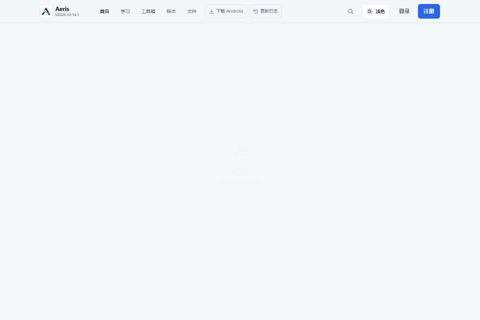
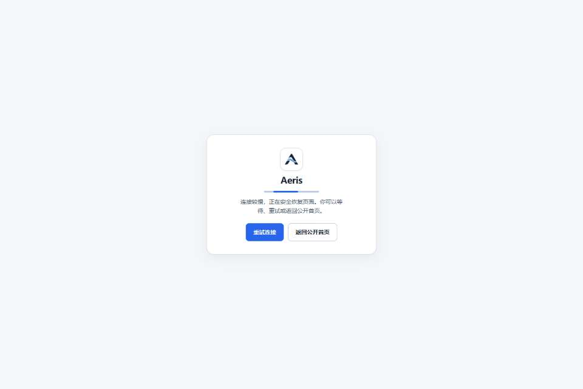

# P07 最终集成、安全审查与门禁记录

本候选修复了实际复现的启动空白、缓存身份先于健康检查展示、登录身份竞态及首帧文字淡化。保留 #132 的 D1 诊断和 #131 的无障碍修复。整体 P07 仍为 **PARTIAL**；本地预检不能代替同 SHA Hosted 与所有者人工验收。

本文件随候选冻结。**最终完整 SHA、该 SHA 的 Core CI 与完整本地门禁收据在新 Draft PR 的最终验收评论中发布**，避免为了向报告填写自身 SHA 而不断改变被测提交。下列已入库证据均保留实际来源 SHA，不外推成最终提交 PASS。

## 固定输入及集成

开始时已重新核对远端：

| 输入 | 完整 SHA | 关系 |
| --- | --- | --- |
| #131 | `7e938bdbda734d319053f1e23fe4a96703486ae6` | 共同祖先 |
| #132 | `91f0d466361ee80fbd6475facea0b9620f950661` | 独立候选基线；保留全部 QA/CI 诊断 |
| #133 | `c19f2907f43eb636891cfadc3c9716e9573c8ef8` | #131 的直接子提交，与 #132 分叉；原 PR 目标为 main |
| 无冲突集成 | `80b54be6eebce13d3205a281823118d68e4afbde` | 两个父提交为 #132、#133；没有重复应用 #131 |

工作分支 `codex/p07-final-integration`，新 Draft PR 目标为 `codex/p07-task25-d1-concurrency`。原 #128–#133 分支没有移动，也未修改 #133 的目标分支。

#133 覆写的 19 个历史 P07-F 证据已先归档至 [flash133](evidence/final-integration/flash133/p07-f)，原路径恢复 #132 版本。[输入清单](evidence/final-integration/INTEGRATION-INPUTS.json) 和 Git 历史保留两者。Flash 报告的部署/证据 SHA 不作为本候选验收。

## #133 Core CI 失败

[原 Run 42375700542](https://github.com/WYJ0904/thewyj.uk/actions/runs/42375700542) 中 JavaScript、Windows Python、Ubuntu Python 同时失败于 `test_quality_regressions_have_explicit_guards`；application 与 Cloud-only 浏览器被依赖关系跳过。[原作业及断言摘录](evidence/final-integration/PR133-CI-RED.json) 保留；仅对机器绝对路径前缀脱敏，完整日志留在原 CI。

旧静态测试定位 `runSplashSequence` 回调中的固定 `showSessionRecovery()` 字面量。控制流确已改变，但不能因此直接删除测试：新流程的 1.8 秒 race 会在健康检查或策略未决时继续路由；未显示 pending 提示，Splash 结束后可见主画布为空。已有本地缓存还可能被当作当前身份。

现在静态测试验证实际安全顺序：先等待健康检查，再等待身份/策略与目标路由挂载，最后才标记 mounted；所有入口路由统一阻止未验证会话；有界启动退出必须提供恢复页。公开分享/传输仅在**无会话**时跳过账户探测，有会话必须验证。原静态安全门禁保留且增强。

## 真实 RED 与定向修复

| 问题 | 原版证据 | 候选行为与通过合同 |
| --- | --- | --- |
| 首启慢公开策略 | #133，真实 API 回答延迟 3200ms，出现没有主页面/恢复提示的帧 | 不把超时视为就绪；2500ms 有界退出至可重试恢复页，权威结果抵达后挂载目标页 |
| 慢身份与旧缓存 | B 会话 + A 缓存，真实健康检查延迟 3200ms；原片出现 A 资料 | 所有恢复会话初始 pending；健康检查前隐藏私有内容、不启动旧账户同步；验证 B 后保留 `/account` |
| 健康服务失败 | #133 没有进入期望的有限安全恢复 | 本地确定性 503：恢复页、重试、返回公开首页均可用；恢复真实服务后原账户页可用 |
| 登录慢策略 | #133 移除过渡后仍为 pending，出现空白帧 | 身份由真实登录验证，策略/路由事件决定挂载；过渡超时进入有限恢复，不预挂半成品工作台 |
| 快速换账户 | #133 未标记外部会话验证 pending | 外部会话立即丢弃旧身份权威；旧健康、策略、登录响应都不能覆盖新身份；实际验证 B 工作区 |
| 重复登录点击 | 真实指针双击 | 仍只有一个登录请求；过渡有序解除 inert、恢复可见焦点 |
| 后台首次加载/刷新 | #133 可标记 ready，但 policy pending、工作区空白、无提示 | 无初始租约的隐藏页进入恢复；不依赖 RAF 清理 Splash；前台真实策略后恢复目标页 |
| 后台已有合法租约 | 实际 Chrome 标签切换与真实续租回答 | 仅当前身份且未过期的租约可续租；超期不无条件延长，OFF/Kill/注销/撤销仍权威；隐藏页功能标志仍 OFF |
| 登录文字对比度 | #132 历史固定扫描 4 节点；#132/#133 首个可见登录帧有效父级透明度小于 1 | 就绪主画布与登录表单显式停止继承淡入，首个可见文字 opacity=1；不增加等待或修改字号、布局 |

[原浏览器结果](evidence/final-integration/PR133-BROWSER-RED.json)、[慢公开策略 DOM](evidence/final-integration/PR133-SLOW-PUBLIC-DOM.json)、[慢身份 DOM](evidence/final-integration/PR133-SLOW-IDENTITY-DOM.json)、[慢登录 DOM](evidence/final-integration/PR133-SLOW-LOGIN-DOM.json) 保留时间、实际可见主页面、焦点、inert 与策略状态。测试使用实际鼠标命中和本地合法测试账户；没有付费 AI 或正式账户。

这些图片是原始 Chrome screencast 帧，来源 SHA 与时间关联见 [证据清单](evidence/final-integration/EVIDENCE-MANIFEST.json)。完整帧序列、逐帧 DOM 和影片 manifest 留在独立工作树的 ignored `docs/migration-evidence/p07-final/`。采集器现在在停止录像前另保存实际合成的 `stable.png`；不将最后一个尚未更新的 screencast 帧误称最终首页。

`completeStartupSplash()` 保留原 450ms/180ms 装饰时长和既有 2500ms 上限，区分 ready/error/timeout。上限只决定进入恢复界面，不授予工作区呈现权限。原 1800ms/2000ms 路由竞争已移除。身份和策略等待使用事件，不用轮询 display 或固定增加动画时间。

## 测试修正及失败保留

- [原运行失败](evidence/final-integration/INTERMEDIATE-RUNTIME-FAILURE.json)：导航日志包含首次未决初始化。现先确认 authoritative ON，再记录往返；之后**所有**变更必须保持 ON，原来忽略 pending 的过滤也已去掉。首次加载仍由独立帧测试严格验收。
- [原 R5 失败](evidence/final-integration/INTERMEDIATE-R5-FAILURE.json)：隐藏冷启动没有先前有效租约，原测试强制要求 ready。现要求有限退出、pending/OFF、没有私有画面、可见恢复操作；保留前台恢复、375px 滚动、确认框、焦点和 Escape 断言。
- 登录期间 B 恢复后 `/login` 合法规范化至 `/`。原“必须留在 /login”假设已改为检查跳转前当前身份/策略，以及真实 B 工作区；另增加 A 登录响应被延迟、B 已验证后的反向竞态。
- 首轮录像失败后未停止 screencast，导致后续用例出现夹具级重复录制错误；修正单用例 finally 清理后重新运行，同次失败记录未覆盖。
- 保护脚本第一次将 `git show` 的末尾换行 trim 掉，误报 SW 差异；修正读取方式，未修改 SW 逻辑来迁就比较。

## 无障碍与视觉保护

原八条发现及严重程度保持不变：

| 规则 | 原严重程度 | 原节点数 | 本轮扩展预检节点数 |
| --- | --- | ---: | ---: |
| aria-prohibited-attr | serious | 1 | 0 |
| color-contrast（账户同步） | serious | 1 | 0 |
| label（工作流导入） | critical | 1 | 0 |
| aria-allowed-role | minor | 11 | 0 |
| landmark-unique | moderate | 2 | 0 |
| page-has-heading-one | moderate | 4 | 0 |
| heading-order | moderate | 2 | 0 |
| landmark-complementary-is-top-level | moderate | 2 | 0 |

[固定工具预检](evidence/final-integration/GREEN-FIXED-F-PRECHECK.json)、[全部默认 axe 规则 51 次扫描](evidence/final-integration/GREEN-FULL-AXE-PRECHECK.json)、[扩展交互](evidence/final-integration/GREEN-F-EXTENDED-PRECHECK.json) 均通过。120 个布局组合包含 375/390/768/1024/1440px、亮/暗色；工作流真实文件导入/执行、学习与账户状态、键盘焦点、模态圈定与恢复通过。原有 gradient/背景图和 aria-controls 的 axe incomplete 继续保留人工复核边界，未屏蔽任何规则或节点。

[#132 原四节点报告](evidence/final-integration/PR132-FIXED-LOGIN-RED.json) 原样保留。其只输出前三个 sampleTargets（authSubtitle/showLoginBtn/showRegisterBtn），不能编造第四个原节点 ID。全页扫描覆盖全部登录节点，并增加[首个可见登录帧](evidence/final-integration/PR132-LOGIN-FIRST-FRAME.json) 的父级透明度记录。静态颜色扫描在动画完成后可能为零，但此前可见帧仍被淡化，不能将它称为假阳性。[中间仍失败的表单动画](evidence/final-integration/INTERMEDIATE-LOGIN-OPACITY.json) 也保留。[修复后四次复核](evidence/final-integration/GREEN-LOGIN-FIRST-FRAME.json) 在普通/reduced-motion、亮/暗主题均为零违规、可见文字 opacity=1。[恢复页额外四次完整 axe](evidence/final-integration/GREEN-RECOVERY-AXE-PRECHECK.json) 同样为零。

[保护记录](evidence/final-integration/PROTECTION.json) 验证 41 个官方品牌/Android 资源 Git blob 与三个悬浮卡片子树不变，HTML 官方引用不变。只更新资源查询版本，未修改 Logo、字标、比例、颜色、透明区或图像内容。

## 预检与最终门禁

预检分开记录，不将不同 SHA 的绿拼成最终提交全绿：

| 门禁 | 预检结果 | 来源 |
| --- | --- | --- |
| 冻结 25、主工作区 3、P4、策略 5、P07-E 32、PWA | PASS | `1c10584652ad43b5052520b448c6baf8b421e00b` |
| 更新后的运行 7、R5 浏览器 13 | PASS | `aef7902bea49d5b507cdab704c02e7110296462b` |
| 启动/身份/策略单元 | 60 条通过 | 原 52 + 本轮 8；Core CI 纳入新增测试 |
| Task25 | 原 31 并发、30/1、恢复/计数/审计合同通过；19 向量通过 | 本地固定原合同，未更改后端 |
| Python | 186 条通过，其中静态 31 | 本地 Python 3.15；CI 另跑固定版本 |
| 首帧登录文字 | PASS，4 次扫描 | `6b8116267458a6fb57ded0a6db8f20f21e4bab0a` |
| 最终完整提交 | 必须冻结后执行完整 ON、OFF、Kill、暖升级和 Core CI | 以 Draft PR 最终同 SHA 收据为准 |

最终资源版本为 **`20261107-aeris-p07-final-rc3`**，由现有 `update_asset_release.mjs` 生成。HTML、JS 模块、CSS 引用和 SW 同源版本统一。`sw.js`、API、会话和路由核心相对 #132 仅版本串改变；功能性变更局限于本任务启动/身份呈现和 #133 的合法隐藏租约续租。服务端、计费、财务账目、套餐、权限/API 合同未修改。

保护脚本确认 #131 与 #132 的 allowlisted Pages 输入完全相同，因此从精确 #132 暖缓存升级同时覆盖这两者的旧客户端资源字节。最终暖升级必须继续验证普通刷新、实际 JS/CSS 哈希、离线、localStorage、IndexedDB 及独立用户缓存保留；不得清理用户缓存来通过。

本地首轮环境失败另留原件：一次 D1 local migration `fetch failed` 在浏览器执行前中止；一次并行端口检查发现 CDP+10 与另一运行 CDP 重叠，执行前中止。重新分配所有服务/CDP/inspector 端口，未降低并发业务断言或覆盖失败目录。

## 性能、剩余风险与部署边界

[Lab 预检](evidence/final-integration/LAB-PRECHECK.json) 分公开首页、登录后首页、账户、财务各 3 次，全部 12 次 LCP 元素位于相应实际容器、均不属于 Splash。环境是 Windows Chrome desktop 1440×960、DPR1、CPU1×、无节流 loopback、HTTP cache disabled、Lab 单独 bypass SW；不是 Hosted 网络性能承诺。最终同 SHA 重跑并在收据中记录。Field INP **NOT_TESTED**，没有 Field 样本。

两个历史问题继续 **NOT_DETERMINED**：Task25 原 CI 23×200/1×429/7×temporarily_unavailable；历史离线复习提交超时。本次未修改相关后端/判题根因，当前合同通过只能说明此次未复现，不能称已修复。

仅当最终精确 SHA 的所有当前可复现门禁通过，才可报告 **INTEGRATION_PASS**；整体 P07 继续 **PARTIAL**，等待 Flash 同 SHA 隔离 Hosted 和所有者人工验收。没有部署 Production、访问正式 D1/R2、操作正式用户/财务、清缓存、启用 AI/OCR、修改 Android 或合并 main。

部署交接见 [P07_FINAL_FLASH_HANDOFF.md](P07_FINAL_FLASH_HANDOFF.md)。
