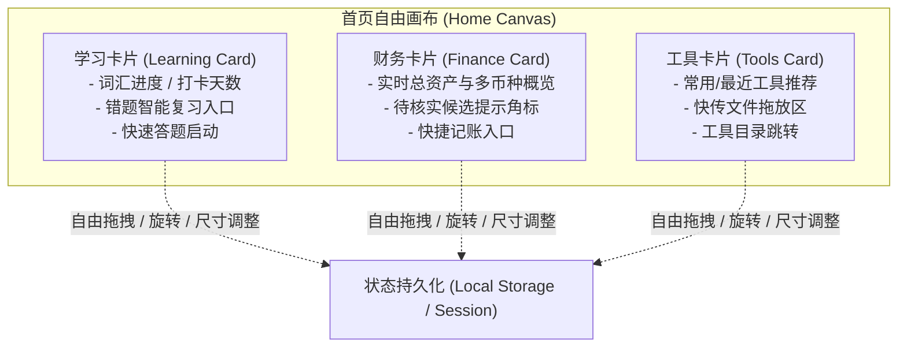

# Aeris V6.2 — P07 视觉重构启动基线与工程就绪方案 (P07 Implementation Readiness)

## 一、状态与准入结论

- **当前状态**：`READY_FOR_P07_PREVIEW`
- **基线版本**：
  - `main`：`3eb268b748a6e7a1aaa7369059db474810bb59d4`（包含已合并的 Android Hotfix PR #110）
  - 财务收敛分支（PR #112）：`d9cf9a7`（已完成全量 Android JVM、多币种契约与端到端浏览器 CI 收敛）
  - 错题复习整合分支（PR #111）：`df67fd0`（CI 全绿，独立增量迁移验证完毕）
  - P07 现有样板分支：PR #115 (`codex/aeris-p07-quality-release`) 与 PR #117 (`codex/aeris-spatial-preview`) 处于安全保护中
- **开工边界要求**：
  - P07 视觉开发严格在独立 Preview 分支进行；
  - 绝不破坏既有业务路由、功能状态机、数据模型与无障碍基线；
  - 绝对不触碰正式生产环境（D1 / R2 / Production Worker / 真实签名 APK）。

---

## 二、全站实际功能与页面路由清单

经对 `js/core/router.js` 中的 `APP_ROUTE_MANIFEST` 与实际控制器审计，系统真实功能路由如下：

### 1. 核心导航与认证
- `/`：首页（包含 Aeris 品牌 Logo、学习/财务/工具箱三张悬浮卡片、模块切换入口、版本更新通知）；
- `/login`：用户登录（支持原生/Web 统一会话恢复、PBKDF2 安全鉴权、自动登出与会话刷新）；
- `/register`：用户注册（用户名规范校验、密码强度校验、初始会话签发）；
- `/account`：账户中心（个人信息管理、已购方案展示、登录历史与设备会话查看）；
- `/trial`：体验通道与功能探索。

### 2. 语言与智能学习
- `/language`：语言学习总览（英语/日语学习入口、错题本汇总、学习天数与连续打卡统计）；
- `/language/english`：英语词汇答题流程（支持单轮复习、发音朗读、错题智能判定与重新申诉）；
- `/language/japanese`：日语词汇学习（五十音图与假名词汇答题、语音速率调节）；
- 错题复习与掌握度（Task 26）：`wrong-review` 控制器集成，基于遗忘曲线的智能间隔复习算法（Mastery 阶段评估、每日答题上限、跨天状态持久化）。

### 3. 财务与交易核实
- `/finance`：财务总览（多币种资产总计、月度收支预算卡片、离线记账同步提示、自动记账变更 Feed）；
- 流水与分类：六币种（CNY, USD, EUR, HKD, GBP, JPY）收支明细列表、分类筛选、币种转换参考；
- 通知保存与人工核实：手机优先布局的候选核查入口（微信/支付宝/银行通知流水、未证实交易注意力中心、人工确认与作废流）；
- 记账弹窗：单笔交易录入/编辑（支持金额输入、多币种选择、分类与商户标签）。

### 4. 工具箱与工作流
- `/tools`：实用工具箱目录（103+ 项轻量工具，分类筛选与搜索）；
- `/tools/:tool_id`：独立工具运行器（文本转换、图片元数据擦除、二维码生成、随机数生成等）；
- `/tools/workflows`：可编排轻量工作流引擎。

### 5. 文件传输与私密分享
- `/transfer`：大文件分块上传与传输面板（支持断点续传、分片哈希校验、超大文件隔离）；
- `/share/text/:id`：加密文本快传提取页；
- `/share/file/:id`：私密文件分享下载页；
- `/share/clipboard/:code`：剪贴板协作提取页；
- `/share/qr/:id`：专属二维码生成与扫码中转页；
- `/share/room/:id`：局域网临时快传房间。

### 6. 会员与结算审批
- `/recharge`：会员充值方案页（8元财务月卡、8元通知月卡、30元全功能年卡、100元全功能永久卡）；
- 支付与结算：专属聚合收款码展示、订单号防重生成、管理员后台人工核验到账与权益手动激活。

### 7. 管理与发布控制
- `/admin`：管理员控制台（用户角色管理、财务审批、系统消息广播、Task 25 功能开关控制）；
- `/changelog`：版本更新日志（全站变更版本历史、免打扰标记）；
- `/download`：Android 客户端与桌面端下载页。

---

## 三、现有设计资产与设计系统规范

- **品牌要素**：
  - 核心颜色：Aeris 经典深蓝主色 (`--aeris-blue-primary: #1a56db`)、交互高亮蓝 (`--aeris-blue-hover: #1e429f`)；
  - 辅助配色：中性浅灰背景 (`--aeris-bg-subtle: #f8fafc`)、容器纯白底色 (`#ffffff`)、边框分割灰 (`#e2e8f0`)；
  - 品牌资产：保留既有 `assets/logo.png`、`assets/brand/aeris-lockup.png`、各分辨率 Favicon 与 Maskable 图标。
- **样式文件层级**：
  - `design-system.css`：设计系统变量、栅格系统、排版基准与色彩令牌；
  - `product-ui.css`：应用组件样式（卡片、按钮、表单、提示横条、模态层）；
  - `public-experience.css`：未登录/游客体验层、公共宣传区布局；
  - `workspace-experience.css`：沉浸式工作区布局、侧边栏自适应、手机响应式断点；
  - `styles.css`：全局基础样式与全局工具类。

---

## 四、P07 悬浮三卡架构与交互契约

根据 PR #115、PR #117 与所有者选定的设计样板，首页首页“学习、财务、工具箱”三张卡片契约如下：

1. **三卡能力契约**：
   - **交互自由度**：支持鼠标/手势触控自由拖动位置（Drag）、角度微旋（Rotate 倾斜反馈）、层级置顶（Z-Index 调度）及尺寸自适应；
   - **数据绑定**：
     * 学习卡：绑定当前账户打卡天数与待复习错题数（`wrongCount`）；
     * 财务卡：绑定当前账户多币种资产总和与待处理候选数（`pending`）；
     * 工具卡：绑定常用工具快捷列表与即时传输拖放区；
   - **状态持久化**：用户自定义摆放位置保存在本地 `localStorage`，重新加载时无缝还原；
   - **降级保护**：在移动端竖屏（宽度 < 640px）或开启 `prefers-reduced-motion` 时，自动降级为规整的垂直流式堆叠卡片，保障触控易用性与操作效率。

---

## 五、回归测试与质量基线要求

P07 实施中必须逐项通过以下自动化与交互基线：

1. **响应式多端分辨率**：
   - 移动端：`390 x 844`（iPhone 13/14 视口）、`412 x 915`（Samsung Galaxy 视口）；
   - 平板端：`768 x 1024`（iPad / 折叠屏折叠态）；
   - 桌面端：`1366 x 768`（标准笔记本）、`1920 x 1080`（全高清宽屏）。
2. **无障碍 (a11y) 门禁**：
   - 满足 WCAG 2.1 AA 标准，文本与背景对比度不低于 4.5:1；
   - 全站组件支持纯键盘操作（Tab 键焦点流、Enter/Space 触发、Escape 关闭模态）；
   - 动效支持 `prefers-reduced-motion` 媒体查询，关闭眩晕型过度位移；
   - 200% 与 400% 页面缩放无内容重叠截断。
3. **Android WebView 专用适配**：
   - 状态栏与导航栏沉浸式安全区适配（`env(safe-area-inset-top)` / `env(safe-area-inset-bottom)`）；
   - 拦截物理返回键，优先用于关闭抽屉与弹窗，无弹窗时触发应用级返回；
   - 禁用 WebView 橡皮筋过度回弹造成的视觉割裂。

---

## 六、P07 推荐实施顺序与安全隔离

1. **阶段 1：设计系统 Token 提纯与规范化**
   - 整理色彩、阴影、圆角、排版变量；不触动业务 JS 控制器。
2. **阶段 2：首页三卡悬浮画布重构**
   - 引入三卡空间布局引擎，整合 PR #115/#117 已验证的手势与物理动效，落地移动端折叠降级。
3. **阶段 3：各业务模块页面容器与侧边栏对齐**
   - 统一学习页、财务页、工具箱、账户中心的导航栏与卡片容器风格。
4. **阶段 4：移动端人工核实流专属优化**
   - 打造手机优先的支付通知核查卡片，突出金额、商户、单号与确认/作废操作按钮。
5. **阶段 5：全量自动化回归与发布评审**
   - 运行 Playwright / DevTools a11y 审计与 Core CI 全流程。
