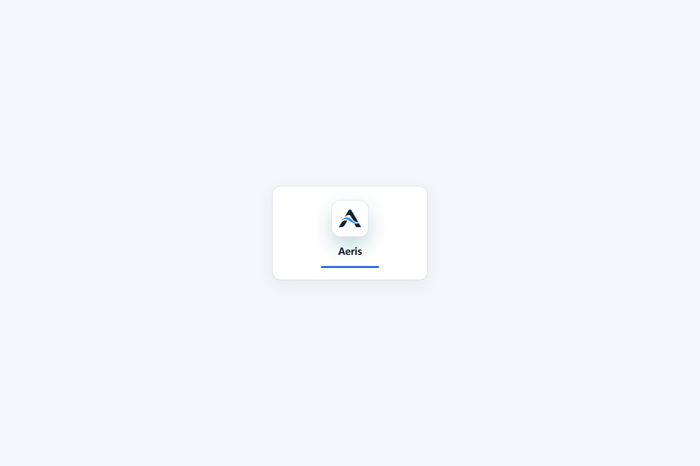

# Aeris V6.2 P07-R4-A 运行机制修复与回归证据

当前状态：`P07_R4A_PARTIAL`。最新冻结套件为 **24 PASS / 1 FAIL**，账户普通刷新启动超时尚未关闭，暂不重新申请人工验收。日期：2026-11-05（香港时区）。
本报告区分固定基线修复、R4-B 接口集成、本地浏览器、Hosted Preview 和 CI；不代表所有者人工验收通过。

## 固定输入与隔离

| 输入 | 固定版本 |
|---|---|
| 原始 RED | `21b83316cbfdeb366c587b9e818a2c64e2199215` |
| 指定产品起点 | `f7949f8253f51ea2621c397743208971c0cec467` |
| 外部 QA PR #124 | `882efdb9978f2608c54bc6c9c19eb8843e80945f` |
| R4-A 单独修复并通过冻结套件 | `252cb86a3c2fb5b81a2a9b525f854b633a32635a` |
| 后续固定集成的 Flash R4-B | `15fdd2b71b2f6a49957720a5aaed0135464f63fc` |
| Hosted 产品资源候选 | `0f2677aaa01f3f1f20e8ba1e76be9fb2dcf204f4` |
| 最新冻结浏览器受测提交 | `6417005f70c34a5fc9bc35493587bd016aae8575` |
| 54 次刷新诊断提交 | `52a07758ebeaf8633184a7d994505cdf32a84583` |
| 发布资源标识 | `20261105-aeris-p07-r4a-runtime-r3` |

分支 `codex/p07-r4a-runtime`，独立工作树 `%USERPROFILE%/.codex/worktrees/p07-r4a-runtime/thewyj.uk`。
[Draft PR #125](https://github.com/WYJ0904/thewyj.uk/pull/125) 的目标为产品分支，未合并 main。
创建 PR 时发现 R4-B 已推送；先保留指定基线的独立通过证据，再只在本工作树集成固定 R4-B。两处冲突位于 `app.js`、`index.html`，保留 Flash 页面内容，运行状态归入统一接口。没有覆盖 Flash、财务或 Task26 工作树。

## 根因与修改

### P0-01：同会话导航退回旧界面

`enabled()` 同时表示业务功能是否可调用及页面应显示哪种模式。隐藏标签、恢复登录和重新请求策略会暂时返回 false；这一瞬态值被立即应用为旧界面。公共策略还曾以账户对象引用判断身份变化，正常账户刷新也会清空同一用户的有效决策。导航入口没有一致取消前一页面的异步工作。

公共及登录策略控制器新增 `decision()`，显式返回 pending/enabled/disabled/error。相同账户的有效内存决策仅在服务端原 TTL 内延续；不持久化、不跨账户、不延长 30 秒有效期。功能调用在隐藏标签／离线时仍关闭，页面模式不再因暂时不可调用而错误切换。权威 OFF／Kill Switch 立即覆盖，网络失败清空授权并进入明确失败回退。

路由变更统一推进 generation；异步财务、工具和文件入口采用自己刚发起的路由 generation，旧请求不能重新打开已经离开的表面。登录恢复时，公共策略不能替有会话的账户决定 ON。

CI 还发现支持中的旧 Python 后端不声明 Task25 能力，会使登录后的模式永久 pending。已在成功读取的后端 status 中将缺少该能力明确判为不可用，安全显示基础界面；普通 API 成功响应缺少该字段不会重置策略。新增真实浏览器响应合同检查及控制器用例，后续 CI 的完整 application 流程已通过。

### P0-02：财务和会员同时显示

财务 `openRecharge()` 绕过主工作区入口，会员加载函数自己揭示 DOM，财务页继续可见。旧关闭逻辑又依赖财务仍可见来判断返回位置，形成耦合。

`openMembershipModal()` 仅保留兼容调用名，统一转入 `showMembership()`；`loadMembershipWorkspace()` 只加载业务数据。`workspaceEntry()` 将安全校验后的返回路由和用途写入 History state。财务入口传入 `goal` 和 `returnTo:'/finance'`；会员进入时统一隐藏其他主工作区，退出时通过路由重新恢复财务，而非保留两个主页面。Back／Forward／刷新沿用对应历史项的用途和返回路径。

R4-B 的临时 `state.membershipReturnPath` 合入这一 History 合同，避免两个返回状态来源。真正的确认框仍由 `.modal-layer` 管理；Android Web 返回先关闭确认框，再退出主页面。账户密钥编辑及会员二维码释放保持原生命周期。

### P0-03：异步 Feature Flag 闪现

原 `boot()` 将 250ms `Promise.race()` 超时当作可以展示旧画布的条件。权威请求延迟 1200ms 时，R3 实测有约 474ms 旧画布可见。

移除该竞速。策略未决时只呈现中性的页面内状态，主画布不呈现错误模式；实际请求超时／失败后显示安全基础界面及明确重试入口，避免无限启动遮罩。此状态不以固定延时决定 UI，也未增加永久全屏覆盖层。错误重试按钮使用现有 `.hidden` 规则，避免全站按钮 CSS 覆盖原生 hidden 属性。

### P0-04：同源升级混用资源

原部署更新了 HTML／脚本内容，却沿用相同资源标识与 SW 缓存键。普通刷新可能取得新 HTML，同时命中旧 `app.js`。激活时统一删除其他缓存也不能保证正在打开的旧客户端可继续加载自身模块。

新资源标识同步覆盖 HTML、模块 import、懒加载、CSS、manifest 引用和 SW。SW install 先下载完整必要 shell 到暂存 cache，全部成功且 HTML 发布标识一致后，先发布资源、再发布离线 HTML。导航读取网络时绕过 HTTP 缓存，只有匹配自身 release 的 HTML 才写入离线入口。资源按请求的 release 选择精确 cache；旧版本 JS／CSS 缺失时不能用当前版本字节冒充。旧客户端所需缓存和其他用户 cache 均保留，API／非 GET 不进入 shell 缓存。

## 严格回归合同

复用 PR #124 固定浏览器驱动，冻结脚本 SHA-256：`227c4f69d473186fdbe307fa3a6da4a9a6d5a0c41d485ff51d19beed608fa61d`。
未合并其整套 QA 文件。适配器仅增加固定候选、隔离证据目录、启动握手及升级资源传输；原始新旧 `app.js` 字节相等断言保持不变。额外检查实际加载的全部 JS／CSS、离线 shell 和用户存储。

| 门禁 | f7949f8 原结果 | R4-A 单独修复 | R4-A + 固定 R4-B |
|---|---|---|---|
| 冻结真实浏览器合同 | 23 PASS / 2 FAIL | 25/25 PASS | **最新 24/25，账户刷新 FAIL**；此前同资源版本曾 25/25 |
| 主工作区排他 | 2/3 PASS | 3/3 PASS | 3/3 PASS |
| 1200ms 公共策略延迟 | FAIL，474ms 旧画布 | PASS，0 错误模式可见帧 | PASS，0 错误模式可见帧 |
| 登录策略延迟／往返／History／确认框 | 无本轮专项 | 6/6 PASS | 7/7 PASS，含旧后端基础界面回退 |
| 同源普通刷新升级 | FAIL，旧 app 字节 | PASS | PASS，另含 48 个实际 JS／CSS 响应字节和离线恢复 |
| OFF／Kill Switch | PASS | PASS | 2 + 2 项 PASS |
| P4 行为三种宽度 | 原错误模态假设 | 390／1366／1920 PASS | 390／1366／1920 PASS |

完整逐项对照见 [browser-comparison.json](evidence/r4a/browser-comparison.json)，DOM、命中坐标、几何、真实账目及权限事实见 [browser-facts.json](evidence/r4a/browser-facts.json)。原失败矩阵保留在 QA #124。最近失败不能由更早的 25/25 替代；证据收集器仍以非零退出并记录 acceptanceGate=FAIL。

独立 Chrome + 实际编译 Pages Functions + 本地 D1/R2；无运行时产品替换、无收费 AI。冻结套件同时验证整卡坐标命中、焦点、侧栏导航、学习卡几何及语言隔离、账目与图表、订单和权限。检查不仅依赖 URL。

定向模块验证：公共策略／鉴权 36/36、Task25 Web/native 合同 19/19、新策略状态 5/5、Core 路由／存储／会话／API、会员八套餐与权益／支付模型、财务金额／筛选／合并模型均 PASS。模块图 57 文件／92 imports、29 类存储键审计及锁定 Wrangler 4.118.0 的真实 Functions 编译 PASS。

## 旧 CI 失败与测试修正

[原 Run 41957228594](https://github.com/WYJ0904/thewyj.uk/actions/runs/41957228594) 的 finance choices 超时属于真实产品调用重入／用途丢失；R4-A 保留用途、三套餐和权益断言，并补充唯一主工作区。账户隐藏超时来自把主页面继续当模态退出的旧假设；冻结套件以真实侧栏命中、焦点、可见主表面和实际导航验证独立工作区。本轮仍明确验证 Escape 和 Android Web 返回的受支持行为。

业务浏览器旧断言“工具权限不足时 URL 保持 `/`”改为进入 `/recharge`，并新增首页／财务／工具表面确实隐藏的检查；原套餐、金额、订单和二维码断言保留。没有通过删除或跳过业务失败获得全绿。

新增专项曾错误点击已隐藏的旧关闭按钮，且在普通刷新丢失测试 opt-in 后等待 Android bridge；更正为真实 Escape，独立重新进入已有 native-navigation 测试入口。另保留本地 fixture 启动竞态及新增图片检查空 src 异常；仅修正测试启动／采样，未放宽合同。中途 Preview 曾遇一个静态文件 HTTP 404，保留失败，最终版本逐字节独立复核。原始日志留在 ignored `docs/migration-evidence/p07-r4a/`，交付摘要见 `evidence/r4a/verification-history.json`。

新 CI 的 reduced-motion 用例还把启动层移除等同于策略已决，立即测得登录输入宽度 0。增加了有界的真实策略状态／表单可见等待，原输入宽度大于 250px 和启动层快速退出断言保持不变。并行测试 staging 改为每次运行只物化固定 allowlist Git blobs，保留原 stagePages 审计；避免多个进程删除共享输出。重复标签在任何写入前拒绝，并实测原证据字节不变。一次中间重复标签曾覆盖外层 provenance 元数据，已明确标记其原 adapter hash 无法恢复；原 source manifest、结果和截图未被覆盖，最终交付使用新标签。

## 未关闭的门禁

**R4A-G01：账户普通刷新启动超时。** 最新冻结 `6417005` 的 `refresh-continuity-all-required-pages` 在 `/account` 普通刷新等待 boot 完成超过 30 秒，原品牌启动层仍可见。没有捕获到 JavaScript runtime error，但现有失败记录不足以证明是产品生命周期、浏览器调度或本地服务原因，不能归因为环境后忽略。

新增只读诊断记录了 DOM readyState、可见性、策略、原计时器／RAF 进度、异常和未完成网络请求。账户／会员／财务的直接打开、普通与强制刷新共 **54 次通过**，全程页面可见，未强制前台、未替换计时器、未更改产品；未重现原故障。这不能关闭原失败，也没有提高 30 秒阈值或跳过账户刷新。复测命令：设置 `P07_R4A_RELOAD_DIAGNOSTIC=1` 后运行现有 gate launcher；[诊断原始数据](evidence/r4a/reload-diagnostics.json)。

后续定位入口为 `boot()` 到 `runSplashSequence()` 的原始启动生命周期及故障当时的计时器／RAF 调度，需在同样失败时取得状态；目前不能把某个调度猜测直接写成根因并盲改启动时长。

**R4A-G02：管理员按钮一次瞬时不可见。** 前一次冻结运行 `370dc90` 为 24/25，批准按钮的严格鼠标采样判为不可见；最新同脚本管理员项通过，包含实际审批、权益、审计与 401/403/200 权限验证。保留 [原失败](evidence/r4a/intermediate-admin-failure.json) 和 [截图](evidence/r4a/intermediate-admin-not-visible.png)。现有管理员视图有 220ms opacity 动画，时序是一个怀疑方向，截图不足以证明根因。未修改冻结 pointer 断言，也未据此修改管理员产品视觉。

两个观察均保留为后续复核输入；G01 仍明确阻断集成放行。没有新一轮反复重跑直到全绿来覆盖这些记录。

## 财务、权限和验收边界

合成账目仍使用收入 1,000,000 CNY、支出 10,000,000 CNY 和 1,000 CNY；正确总收入 1,000,000、总支出 10,001,000、余额 -9,001,000。冻结浏览器验证真实本地账目、编辑／删除／空状态及图表更新，不将原截图正确算术误报为错误。本轮没有重新设计图表或集成 PR #123 六币种链。

管理员通过本地原合法 seed／API 创建，普通账户通过注册 API 创建；订单人工审核、权益生效边界、普通会员不能读管理员接口及密钥更改撤销旧会话由实际本地服务验证。Hosted Preview 未授予／修改账户权限，后台身份界面验收仍只计本地隔离证据。

Android 返回证据是既有 Web 导航入口的 Chrome 回归，不是真机或新 APK 验收；未启动 Android Stable。真实 AI 质量、真实付款、所有者已有 Chrome profile、物理触摸及人工视觉验收均不改写为 PASS。

## 官方 Logo 保留

`brand-guard.mjs` 对指定基线核对 43 个品牌／Android 资源 Git blob，并逐字节比较图像 SHA-256。Header／登录／PWA／favicon／Android 资源无内容改动；`index.html`、manifest、SW、app 中原有 Logo 路径及引用数量相同。允许的变化只有发布版本查询参数。升级离线检查还确认原 `/assets/brand/aeris-lockup.png` 实际加载成功。

## Hosted Preview 与 CI

最终候选独立 Preview：[14d4c47b](https://14d4c47b.thewyj-p07-ui-rc.pages.dev/)，分支别名 `codex-p07-r4a-runtime`，与 Flash 别名分开。部署仅物化已提交 allowlist Git blobs；隔离 Preview D1 固定，R2/AI bindings 为 0，AI OFF，无远端迁移或账户操作。86 个公开静态文件 HTTP 200 + SHA-256 匹配。

原截图脚本只等启动层移除，可能拍到策略未决画面；最终发布器增加显式非 pending、实际首页可见和原 Logo 已加载的验证。Hosted 仅作为公开访客界面及资源完整性证据，不冒充管理员／会员 Hosted 全流程。

[Core CI 42013739936](https://github.com/WYJ0904/thewyj.uk/actions/runs/42013739936) 的 application 暴露真实旧后端 pending 回归；[42014908673](https://github.com/WYJ0904/thewyj.uk/actions/runs/42014908673) 在业务流程通过后暴露移动表单就绪假设。失败均保留，修复方式分别为产品能力状态处理、测试的真实可见性等待。

当前 [Core CI 42016094018](https://github.com/WYJ0904/thewyj.uk/actions/runs/42016094018) 对应 `6417005`：**7 success / 1 failure / 2 skipped**。application 成功；Cloud-only 在旧 PWA 断言 `Only the current Service Worker cache should remain` 失败。中间提交自动取消的 run 保留 cancelled，不作为 PASS。

旧 PWA 测试手动注册无版本 `/sw.js`，并以固定 500ms 后的任意 Cache Storage 快照要求“只有当前缓存”。这一假设不支持新合同要求保留的旧客户端和用户缓存，也没有明确等待 install 暂存完成；该次 CI 没有记录具体 cache keys，不能断言究竟是哪一个额外键触发。原错误、job 和 checkout 证据保留在 [ci-evidence.json](evidence/r4a/ci-evidence.json)。

PWA 测试已改为注册与应用一致的 release-qualified SW，并有界等待当前 release 控制客户端、必要 app 字节存在且暂存结束。通过精确集合和原始字节验证当前 shell、一个旧客户端 fixture 和一个无关用户 fixture，同时保留 API 禁入缓存、离线访客、联网恢复，且新增实际首页可见性检查。没有允许任意缓存键，也没有去掉敏感数据断言。该修订在 `fb6ef9a` 的实际编译本地 Pages + Chrome 中 PASS，[结果](evidence/r4a/p5-pwa.json)。新 CI 尚待最终推送后运行，不能记为 CI PASS；即使成功也不覆盖 G01。

[release-equivalence.json](evidence/r4a/release-equivalence.json) 逐一验证 147 个受允许发布文件：受测提交、Hosted 提交和交付父提交的 Git 字节相同。后续报告／QA 提交不改变这些产品资源。完整文件及截图 hash 见 [证据清单](evidence/r4a/evidence-manifest.json)。

## Gemini Flash 接口交接

- 会员入口调用 `showMembership(true,{goal,returnTo})` 或兼容 `openMembershipModal({goal})`；不得再自己揭示会员 DOM，也不得靠保留财务页实现返回。
- `history.state.aerisWorkspace` 是账户／会员返回上下文唯一来源；保留现有字段，不另加 `membershipReturnPath` 状态。
- 页面模式读取策略 `decision()`；业务调用继续使用 `enabled()`，两者语义不同。不要在导航／render 中直接重置根 P07 属性。
- 视觉工作可继续修改 R4-B 内容容器；真实确认框继续使用 modal-layer，主工作区不声明 aria-modal。运行代码集中在 app 的工作区入口／policy boot、router、两个策略控制器和 SW。
- 每次更改静态资源发布字节，运行 `node scripts/update_asset_release.mjs <新的唯一发布标识>`，同步整条模块图和 SW；保留现有官方品牌资产。
- 复测：`node qa/p07-r4a/run-gates.mjs <新标签> --compiled-runtime --round3 --primary-workspaces --p4-workspace`；再分别加 `--flag-off`、`--kill-switch`，升级使用 `--compiled-runtime --cache-upgrade --warm-baseline`。测试根为固定 QA PR #124；环境端口必须隔离。
- 新 Preview 使用 `node qa/p07-r4a/deploy-preview.mjs --commit <明确SHA>`，只沿用既有 allowlist 发布器和本任务 Preview 分支。

未修改 Production、正式 D1/R2、正式策略／账户权限、签名、Stable 或手机数据；未调用 Claude。G01 尚未关闭，当前只交付可审查的运行机制修复与真实红灯证据，保持 Draft，不宣称已可人工验收。
