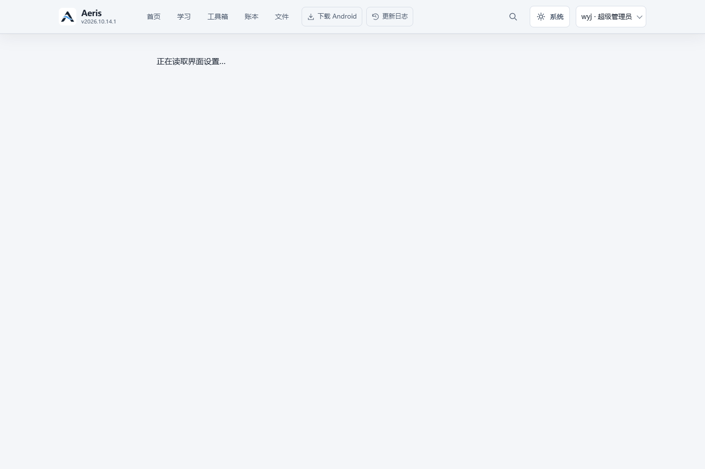
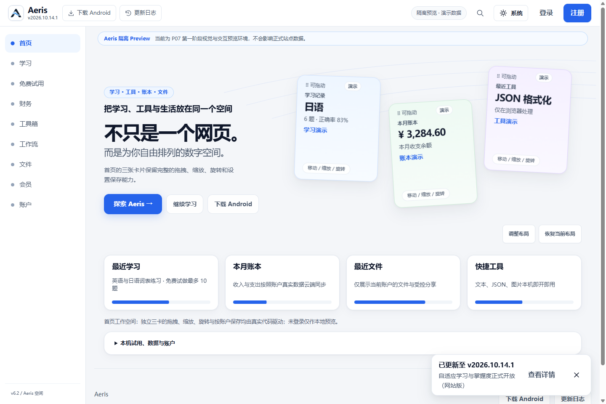

# P07-R4-C 运行门禁与 P07-E 联合集成

日期：2026-11-06，Asia/Hong_Kong。当前 `P07_R4C_PARTIAL`。运行代码冻结验收已通过；最终 HEAD 的 Core CI、同 SHA 的 Flash 隔离部署和 F 发现的复核尚待关闭。保持 Draft，不将部署成功或工具 READY 当成人工验收通过。

## 固定输入与 ancestry

| 输入 | SHA |
|---|---|
| R4-A / PR #125 | `0c87169aa4b75db4d00fe76a66bd32a62ead9e4a` |
| R4-B / PR #122 | `15fdd2b71b2f6a49957720a5aaed0135464f63fc` |
| P07-E / PR #126 | `22d71bd428f6d6bee71ea7140bc5e65650c9c547` |
| 冻结 QA / PR #124 | `882efdb9978f2608c54bc6c9c19eb8843e80945f` |
| P07-F 工具 / PR #127 | `bf07d4007599f67f3ac23038115ec7e7f299c9a9` |

`merge-base(R4-A,P07-E)` 为 R4-B；R4-B 已是两个输入的祖先。P07-E 独有一个提交，产品增量为 spatial-experience.css，另有其 QA 和历史截图。集成 merge `a09f991124c6a15ee2267c42012e866c38c5d614` 无内容冲突，没有重复应用 R4-B。复用现有干净隔离工作树，新分支 `codex/p07-r4c-integration`，旧 R4-A 分支及全部原失败证据保留。

P07-F 的 merge-base 为 P07-E `22d71bd`，独有增量仅为 QA／报告；merge `470c57fd0ce7f761b3b06497706bca1483f2b5aa` 无冲突，没有再应用 E／R4-B 产品文件。新 [Draft PR #128](https://github.com/WYJ0904/thewyj.uk/pull/128) 以固定 R4-B 产品分支为目标，涵盖 R4-A、E 与后续运行修复，未合并 main。

## G01：启动等待渲染帧的无界路径

历史账户普通刷新 30 秒超时仍保留在 R4-A 报告和截图；其当时未记录页面可见性，不能事后补造归因。

本轮用同一 R4-A 的 Git 字节，在真实 Chrome 中将账户标签置于后台再普通刷新。计时器在 1.7 秒、2.7 秒运行，页面 readyState=complete、appShell 已 ready，RAF 帧数为 0，原 Splash 仍存在；切回前台才完成。旧 `runSplashSequence()` 把清理和 Promise resolve 放在 RAF 回调之后，构成可确定复现的无界等待路径。[MDN 对后台 RAF 暂停的说明](https://developer.mozilla.org/en-US/docs/Web/API/Window/requestAnimationFrame) 与实测一致。

修复提取为 `js/core/startup.js`：沿用原 450ms 展示和 180ms 退出时长，清理不依赖任何 RAF。错误回调也会移除 Splash 并拒绝 Promise，由现有 session recovery 界面处理；不转入未经验证的账户页。增加只读 bootState 阶段用于以后故障取证。没有增加启动延时、提高测试超时或修改 Logo。

固定 baseline probe `r4c-fixed-baseline-red` 在 `0c87169` 上明确 FAIL；同一背景清理断言在修复后 `ac59872` 上 PASS，后台仍为 hidden、RAF 仍为 0，但 Splash 已移除，前台账户恢复正常。四项单元合同覆盖无帧、原时长、reduced motion、异常清理；均 PASS。此证据关闭了已证明的等待路径；历史那一次故障的具体调度状态仍不可追溯。

## G02：联网后测量发生在策略 pending

[失败 CI 42018783175](https://github.com/WYJ0904/thewyj.uk/actions/runs/42018783175)，Cloud job `127217741420`，`test_tools_browser.mjs:1456`：viewport=1366，workspaceLeft=workspaceRight=runButtonHeight=0。

固定 R4-A 的真实页面记录：工作流路由始终 `/tools/workflows`，工作流本身未带 hidden；离线可操作。恢复联网并暂缓实际 `/api/features` 响应时，policy=pending，主画布按合同暂不显示，几何为 0；释放原真实响应后，policy=enabled，工作区宽 1157px，按钮高 44px。没有后台导航覆盖。

修正旧测试的就绪条件：恢复联网后有界等待权威策略及实际工作区／按钮可见，再测量。原视口边界、按钮至少 44px、对比度和工作流操作断言全部保留，另加路由保持断言。没有改产品的 fail-closed 决策或用 display/z-index 伪造通过。完整 Cloud-only CI 尚待最终候选验证。

## 集成边界与定向验证

最终资源版本：`20261106-aeris-p07-r4c-rc2`，由现有 update_asset_release 脚本同步；新增 startup 模块列入必要离线 shell。R4-A 的 decision、History workspace、单一主工作区和缓存发布合同保留，P07-E 样式按其原增量合入。

### 暖升级发现的兼容缺陷

最初候选在 R4-A 同源普通刷新升级时真实失败：R4-A 已安装的 SW 将所有未知版本的 `?v=` JS/CSS 都返回 503，新 HTML 无法执行注册新版 SW 的 app。该红灯保留，未改成强制刷新验收。

迁移后的静态资源使用相同唯一 release 值的 `?release=`，这是旧 SW 能正常透传、且缓存键不会碰撞的兼容入口；Logo 路径和文件字节未变。新 SW 同时识别 v/release，并仅允许其刚从可信导航 HTML 观察到的其他 release 去网络加载，未观察到的旧模块缺失仍拒绝；未来半成品不写入当前离线 shell。脚本保留 `--release-query` 作为一次迁移选项，后续版本更新延续现有规范。

同一固定 R4-A → rc2 的普通／强制刷新字节与离线恢复验收现已 PASS，49 个实际 JS/CSS 响应字节均核对；API 禁入、旧客户端精确缓存及当前离线 HTML 不污染由新增 SW 合同测试覆盖。静态测试原先把 v 参数名硬编码为合同，本轮仅改为新 canonical release 参数，唯一版本、资源清单及模块边断言均保留，31/31 PASS。13 项策略／启动／SW 合同单测 PASS。

已完成：

- G01 严格 RED → GREEN；G02 实际策略／路由／几何对照。
- P07-E 四个页面 × 375/390/1024/1440 × light/dark，共 32 项实际布局检查 PASS；工作流真实本地执行、管理员功能页、候选编辑／取消均检查。
- 管理接口匿名 401、普通用户 403、合法本地管理员 200。
- 候选数据通过隔离 pending-summary 测试替身进入原控制器，没有手工写产品 DOM、运行 AI/OCR 或确认写账。
- 模块图 58 文件、93 imports；29 类存储键兼容检查；43 个官方品牌／Android 文件和语义引用保持不变。

## 已完成的独立运行验收

| 门禁 | 实际结果及证据层级 |
|---|---|
| 冻结浏览器 | **25/25 PASS**，实际编译 Pages + 本地 D1/R2 + 独立 Windows Chrome |
| 主工作区排他 | **3/3 PASS**，直接账户／会员和财务升级入口 |
| 路由、上下文、账户刷新、模态及 Android Web Back | **7/7 PASS**，包括旧后端安全回退和 1200ms 登录策略延迟 |
| 慢公共策略 | PASS，1200ms 条件下错误模式可见帧为 0 |
| OFF / Kill Switch | **2 + 2 PASS**，真实隔离本地策略服务 |
| 暖升级及离线 | PASS，从固定 R4-A 普通刷新到 rc2；49 个 JS/CSS 实际字节一致，localStorage／IndexedDB／无关 Cache Storage 保留 |
| PWA | PASS，精确当前／旧客户端／用户 fixture 缓存集合，API 不缓存，离线可见和联网恢复 |
| P4 / E | P4 390/1366/1920 PASS；E 375/390/1024/1440、双主题 **32 项 PASS** |
| 官方 Logo | 43 个品牌／Android 资源 blob 与原图像字节、语义路径均保持不变 |

冻结受测提交为 `cef7db9bc4ffd3e2641df4e190ba5938a1b4ff34`；暖升级候选为 `74d166a48f5101932d8b72cdbb2b54781ee5812e`。后续修改为 QA／报告，148 个 allowlist 发布文件逐一验证 Git 字节相同，见 [等价性清单](evidence/r4c/independent/release-equivalence.json)。这不能替代 Cloudflare 的精确部署 SHA 检查。

原冻结脚本 SHA-256 保持 `227c4f69d473186fdbe307fa3a6da4a9a6d5a0c41d485ff51d19beed608fa61d`。原 R4-A 超时截图、初始暖升级失败及本轮测试修正历史均保留，没有删测试、提高超时或反复执行无变化矩阵直到偶然通过。

## Core CI 的真实失败与修正

- `42018783175 / 0c87169`：原 G02 工作区为 0；已通过受控真实策略响应复现就绪竞态，修正时序，原几何／对比度／操作断言全部保留。
- `42149831750 / cef7db9`：application 的缓存存在性检查仍查旧 `?v=` 键。实际资源已 canonical 为 `?release=`；七个缓存检查改为精确新键，所有原布尔与导航断言保留。
- `42150712336 / c8ff0aa`：application PASS，Cloud-only 在 P6 parked-row 深比较失败。测试以 v 导入 parked-rows，而产品 keyed-list 以 release 导入同文件，形成两个 ES module／WeakMap 实例。统一四个 QA 文件的当前资源 URL，不改产品行管理，也不改任何行身份／草稿／删除／空状态／reduced-motion 预期；真实 Chrome 定向回归 PASS。

上述失败不是部署失败，也没有被本地局部 PASS 改写为 CI PASS。最终新 HEAD 的 Core CI 必须独立完成；精确运行结论以 [PR #128 Checks](https://github.com/WYJ0904/thewyj.uk/pull/128/checks) 和最新验收评论为准。本报告构建时最后一个完整 CI 仍是旧 c8 的失败，最终提交后的新运行尚待验证。

## Preview、公开策略与登录策略分层

| 项目 | 已观察事实 | 结论 |
|---|---|---|
| 自动 Preview `eb0120ec.thewyj-uk.pages.dev` | 所有者记录 public enabled=false / revision=0 / reason=missing | 缺环境 Flag 时正常 Fail-Closed，不是本轮 SW 失败 |
| Flash 隔离 Preview `41379237.thewyj-p07-ui-rc.pages.dev` | Cloudflare API 独立核对为 preview，部署 `c8ff0aa`，隔离 D1 `ee869f78`，R2/AI 0，AI OFF | 已证实隔离，不操作正式／未证实数据库 |
| 未登录公开策略 | 实际 public enabled=true / revision=17；V3 首页和鼠标导航可用 | 指定 c8 快照 PASS |
| 合法 QA 会员账户策略 | 真实 UI 登录后 `/api/features` 的 account_id 与 `/api/me` 相同，p07 enabled=true，普通会员管理员接口 403 | 指定 c8 快照 PASS，无权限扩大 |
| 主画布与 History／刷新 | 16 个实际页面／命中检查，单一主表面、非 inert，Back/Forward、普通及强制刷新 PASS | 指定 c8 快照 PASS |
| 最终 HEAD 部署 | Flash 当前部署仍为 c8，之后已合入 F 工具及 QA 修正 | **不同精确 SHA，不能凭产品字节等价推进最终 READY** |

联合快照 [41379237](https://41379237.thewyj-p07-ui-rc.pages.dev/) 的 [独立记录](evidence/r4c/independent/hosted-joint-c8.json) 来自 Codex 自己的浏览器和只读 Cloudflare 元数据检查，不直接采用 Flash 报告的 READY 状态。测试仅使用其已交接的普通 QA 账户；凭据不写 Git／报告／PR，不执行外部辅助脚本，不改远端 Flag 或账户权益。Hosted R2 缺失，不能把文件页呈现当成 Hosted 上传服务通过。

按所有者补充要求，配置和部署责任由 Flash 承担，Codex 此后停止重复部署／配置操作。最终候选准备好后须由 Flash 返回相同精确 SHA 的隔离 URL／deployment，再完成必要复核。部署交接见 [P07_R4C_FLASH_HANDOFF.md](P07_R4C_FLASH_HANDOFF.md)。

## P07-F 在统一候选上的实际状态

P07-F 已在 `ca203c95ca3f022a1f14c0a56b00d29292adbf0e` 的统一候选上执行。复用固定隔离 Pages、D1/R2 和 Chrome，扫描前分别等待公开与账户 V3 权威 ON，未启动第二套配置或写远端库。原 F 历史结果和截图保留，新结果在独立证据目录。

实际执行了 10 个工作区 axe、键盘／焦点、7 宽度、主题／reduced motion 和 Lab 性能。**8 项发现，其中 3 条 serious/critical 规则**：`aria-prohibited-attr`（学习）、`color-contrast`（账户）、`label`（工作流）等。未重新开发冻结页面来处理这些 F 阶段发现，仍需归属与复核；原工具的 `P07_F_PREFLIGHT_READY` 只表示产物准备好，新增统一验收状态为 `REVIEW_REQUIRED`，进程非零退出，没有冒充无障碍 PASS。

Lab 样本 TTFB 16ms、FCP/LCP 340ms、CLS 0、TBT 44ms，但 LCP 元素是 `splashImage`；不能据此认定主工作台首屏性能合格，Field INP 未测。详见 [F 实际数据及边界](evidence/r4c/independent/f-quality-boundaries.json)。

## 剩余门禁与复测

1. 最终 HEAD 的 Core CI 完整通过，尤其 Cloud-only 后续工具／工作流／身份流程；旧失败不能被部署成功覆盖。
2. Flash 部署同一最终 SHA，公开及合法登录账户策略均 V3 ON，完成必要联合复核。
3. F 的 8 条发现及主画布性能测量有效性仍需处理／复核；不是已关闭的性能／无障碍发布门禁。

现有命令继续复用 `qa/p07-r4a/run-gates.mjs`，设置 `P07_QA_ROUND=p07-r4c`；冻结用 `--compiled-runtime --round3 --primary-workspaces --p4-workspace`，暖升级加 `--cache-upgrade --warm-r4a`，另分别运行 OFF／Kill Switch。F 用 `P07_R4C_F_ONLY=1`，只复用隔离服务，不覆写 Flash 原报告。所有新标签拒绝覆盖历史证据。

最终人工验收状态 **HELD**。完整可审计文件与截图 hash 见 [独立证据清单](evidence/r4c/independent/evidence-manifest.json)。

没有合并 main、发布 Production、改正式 D1/R2／权限／策略、启动 Android Stable、清除真实数据或调用 Claude。
