# Aeris V6.2 P07 — Round 3 独立浏览器验收

日期：2026-11-05，Asia/Hong_Kong。最终状态：**`P07_ROUND3_QA_PARTIAL`**。

**当前不能重新申请人工验收。** 最新固定候选已经修复财务套餐目标丢失，但从财务升级进入会员时仍同时显示两个主工作区；慢策略响应仍闪现旧布局；同源升级仍可混用新 HTML 与旧缓存 JS；两个主页面仍声明为模态对话框。CI 绿灯没有覆盖这些失败条件。

本次只修改 QA、报告和证据。没有修改 Flash 产品实现，没有合并 main、部署 Production、远端迁移、修改正式 D1/R2/开关/账户权限、调用收费模型或操作手机。

## 1. 固定版本与测试来源

| 版本 | 精确 SHA | 独立来源 | 用途 |
| --- | --- | --- | --- |
| 原始 RED | `21b83316cbfdeb366c587b9e818a2c64e2199215` | `p07-round3-red-baseline` detached worktree；[Preview](https://3e07b5fd.thewyj-p07-ui-rc.pages.dev/) | 保留所有者确认失败的版本 |
| 所有者指定修复后版本 | `fb936d109d0900d02d35eb3493212e4c32c39699` | `p07-round3-flash-review` detached worktree；[Preview](https://13dbeea6.thewyj-p07-ui-rc.pages.dev/) | 原任务 RED → GREEN 对照 |
| 收尾时发现的 CI 修复候选 | `f7949f8253f51ea2621c397743208971c0cec467` | `p07-round3-final-ci-review` detached worktree；[Preview](https://a6e61c0e.thewyj-p07-ui-rc.pages.dev/) | 额外固定后复测，未覆盖前两个结果 |

QA 工作树：`%USERPROFILE%/.codex/worktrees/p07-round3-independent-qa/thewyj.uk`；分支：`codex/p07-round3-independent-qa`。上述源快照均无 tracked 改动，测试只在忽略路径生成 allowlist staging。

运行环境为 Windows Chrome **156.0.8078.80**、Node **24.18.1**、锁定 Wrangler **4.118.0**，实际编译的 Pages Functions 运行于锁定 Miniflare，使用每次新建的本地 D1/R2、随机本地凭据和独立 Chrome profile。AI binding 不存在，`WORKERS_AI_ENABLED=false`。实际鼠标/键盘采用 CDP 输入事件，触摸采用 Chromium 触摸模拟。

复用了上一轮独立 QA 的 P07-D 启动器、编译版服务适配器和现有 `browser_harness.mjs`，没有重建工具框架或重跑 104 个工具。原始日志、数据库及随机密钥保留在忽略的 `docs/migration-evidence/p07-d/`；共享 JSON 不包含会话令牌、Cookies、登录密钥或真实财务文字。

## 2. 结果矩阵与严格门禁

同一份冻结的 `browser.mjs` 在三个固定 SHA 上执行，25 个用例全部实际运行，未跳过失败项。脚本哈希在各自 `driver-manifest.json` 中一致。后补的“主画布只能有一个当前页面”用例在三个 SHA 上使用同一脚本单列运行，避免把 URL、侧栏高亮或仅存在一个会员 section 当成页面验收。

| 套件 | RED `21b8331` | 指定候选 `fb936d1` | 额外候选 `f7949f8` |
| --- | --- | --- | --- |
| 25 项浏览器合同 | **13 PASS / 12 FAIL** | **22 PASS / 3 FAIL** | **23 PASS / 2 FAIL** |
| 三项主页面排他检查 | **0 PASS / 3 FAIL** | **3 PASS / 0 FAIL** | **2 PASS / 1 FAIL** |
| OFF 与 Kill Switch，各两项 | **4 PASS** | **4 PASS** | **4 PASS** |
| 原 P4 CI 账户合同的增强替换，390/1366/1920 | 不作为新合同 PASS | **3 宽度 PASS** | **3 宽度 PASS** |
| 题目/反馈内容列补测 | 两语言均保留空列，**FAIL** | 两语言实际内容及三宽度测量 **PASS** | 原 25 项中的两语言答题和尺寸再次 PASS；未重复补测套件 |
| 同源 RED → 候选的暖 SW 升级 | 起始缓存版本 | 普通刷新 **FAIL**，强刷新资源 | 普通刷新 **FAIL**，强刷新资源 |

完整逐项矩阵、DOM 与坐标分别见 [原始对照](evidence/round3/comparison.json)、[三版本对照](evidence/round3-latest/comparison.json)、[RED 结果](evidence/round3/red/results.json)、[fb936d1 结果](evidence/round3/candidate/results.json)、[f7949f8 结果](evidence/round3-latest/round3-browser-results.json)。所有失败使进程返回非零；没有自动更新 golden、修改业务预期或将期望红灯改写为 PASS。

## 3. 当前仍未关闭的缺陷

### R3-01 / P1：最新候选从财务升级进入会员，两个主页面同时暴露

复现：新普通测试账户 → `/finance` → 实际鼠标点击“查看财务会员”。在 `f7949f8`，路由变为 `/recharge`，财务用途和三张套餐卡已经正确选择；但 `#financePage` 没有隐藏，会员页面接在财务页面下面。屏幕同时显示“财务”和“会员充值”，不是独立主工作区。

实测主表面为 `['financePage','membershipModal']`。财务矩形为 `x=236,y=87,w=1157,h=323.06`；会员矩形为 `x=214.5,y=458.06,w=1200,h=1000`，两者都在视口中。直接访问 `/recharge` 和 `/account` 则各自只显示一个页面。`fb936d1` 的这个排他检查通过，说明这是 CI 修复后的新回归。[三版本同一断言证据](evidence/round3-latest/primary-f7949f8.json)

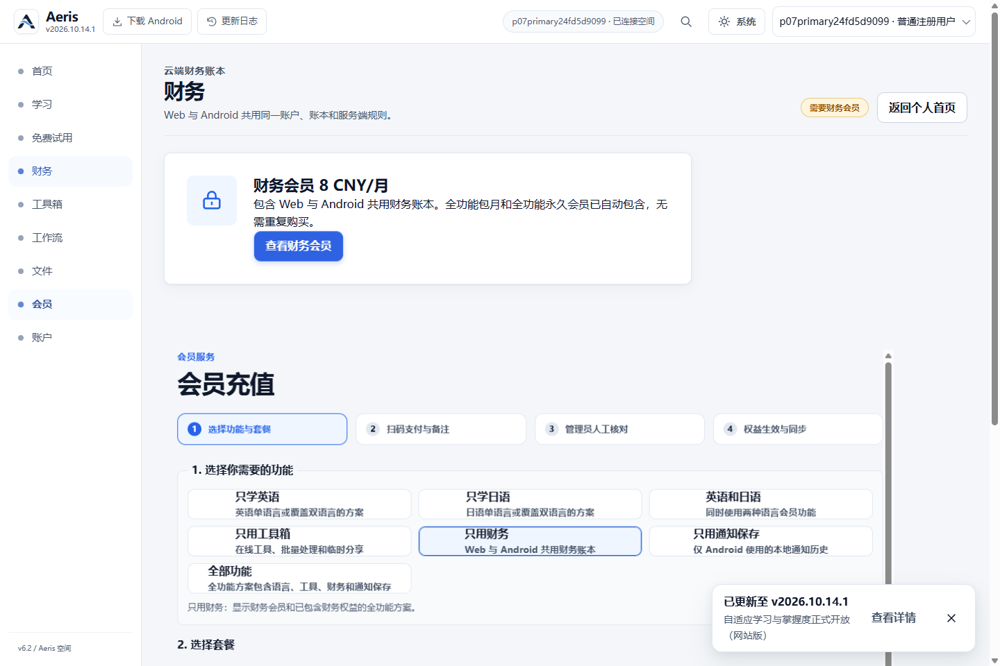

根因：[最新 app.js 的财务 `openRecharge`](https://github.com/WYJ0904/thewyj.uk/blob/f7949f8253f51ea2621c397743208971c0cec467/app.js#L4838) 直接调用 `openMembershipModal({goal,insideWorkspace:true})`；该函数只解除会员 section 的隐藏，没有执行 `showMembership()` 中的 `hidePrimaryScreens()`。保留财务页以兼容关闭后的旧测试，造成两个工作区共存。

通过标准：财务升级入口仍保留 finance 目标和原三套餐，但当前主画布只暴露会员工作区；关闭/返回可以恢复财务上下文，不能靠保留两个可见页面满足返回按钮测试。

### R3-02 / P1：慢速权威开关响应下仍先呈现旧布局

普通、强制刷新及直接打开首页、英语、日语、财务、会员和账户，在本地快速响应条件下均能稳定显示当前页面。另用独立确定性传输条件，将**新鲜的真实本地 `/api/ui/features` 响应延迟 1200ms**，不修改策略值或 UI。实际 RAF DOM 和浏览器截图显示：

| SHA | 可见旧布局帧 | 首尾时间差 |
| --- | ---: | ---: |
| `21b8331` | 189 | 802.7ms |
| `fb936d1` | 180 | 832.2ms |
| `f7949f8` | 108 | 474.0ms |

这是本地浏览器在可重复网络条件下的失败，未冒充现场网络耗时。统计排除了 pending shell 和仍可见的启动 splash；不是只观察 `data-p07-ui` 的瞬时属性变化。[最新时间线与失败 DOM](evidence/round3-latest/round3-browser-results.json)

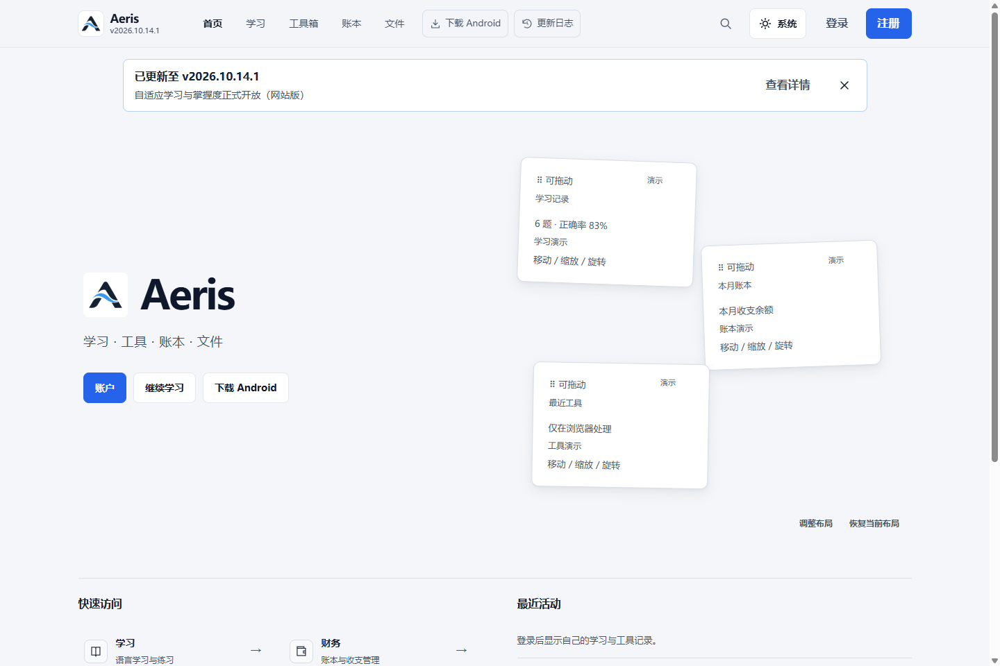

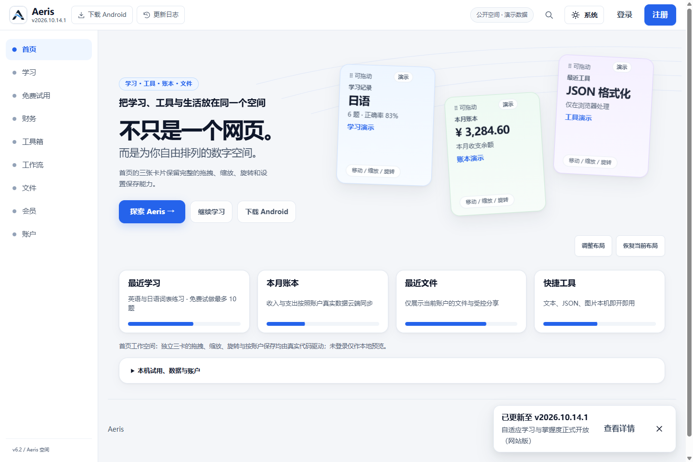

根因：`fb936d1` 的静态 `data-p07-ui="enabled"` 会在 boot 时被 pending/默认 OFF 决策重置，再异步开启。最新版本已移除静态属性，但 [boot 的 `Promise.race(...,250ms)`](https://github.com/WYJ0904/thewyj.uk/blob/f7949f8253f51ea2621c397743208971c0cec467/app.js#L7017) 仍允许权威请求尚未完成时继续揭示画布。250ms 只缩短了本次失败窗口，没有关闭竞态。

通过标准：同样的延迟、OFF、Kill Switch 和请求失败条件下，首次真正暴露的主画布应与已裁决模式一致；不能再用固定等待或永久遮罩掩盖切换。

### R3-03 / P1：同源升级会混用新版 HTML 与旧缓存 app.js

额外测试使用独立 loopback GET 代理：先提供精确 RED 字节并等待 SW 缓存就绪，再在**同一来源**提供精确候选字节。没有改源工作树、Hosted 或 Production。

| 阶段 | HTML 账户标签 | app.js 响应 | 实际 app.js SHA-256 |
| --- | --- | --- | --- |
| RED 冷加载 | `DIV`，在主画布外 | 网络 | `b61a49d7…309b94c` |
| 升级到 `fb936d1` 后普通刷新 | `SECTION`，在主画布内 | `fromServiceWorker=true` | 仍为 `b61a49d7…309b94c` |
| 升级到 `f7949f8` 后普通刷新 | `SECTION`，在主画布内 | `fromServiceWorker=true` | 仍为 `b61a49d7…309b94c` |
| `f7949f8` 强制刷新 | 新版 `SECTION` | 网络，SW controller 为 null | 正确的 `f189f0e5…8359c91` |

完整响应 requestId、原始哈希、缓存键和服务请求见 [原指定候选升级](evidence/round3/cache-upgrade.json) 与 [最新候选升级](evidence/round3-latest/cache-upgrade.json)。实际 owner 的既有浏览器 profile 未被读取或清理；该结论是可重复的本地升级合同失败。

根因：三个版本继续使用 `?v=20261104-aeris-p07-phase1-r2` 和相同 SW cache 名，而 [sw.js 的静态资源策略](https://github.com/WYJ0904/thewyj.uk/blob/f7949f8253f51ea2621c397743208971c0cec467/sw.js#L151) 优先返回缓存。版本查询串存在不等于版本已经变化。独立部署 URL 各自新 profile 的资源匹配，不能替代同源暖缓存升级验收。

通过标准：已有旧缓存的同源客户端在普通导航后也必须执行同一发布版本的 HTML/JS/CSS；再次运行升级测试须全部匹配目标 SHA。强制刷新一次成功不能关闭这个门禁。

### R3-04 / P2：会员和账户主页面仍声明为模态对话框

最新 `index.html` 的主页面 section 已移入主画布，但内部仍有 `role="dialog" aria-modal="true"`。[会员行 1091](https://github.com/WYJ0904/thewyj.uk/blob/f7949f8253f51ea2621c397743208971c0cec467/index.html#L1091)、[账户行 1147](https://github.com/WYJ0904/thewyj.uk/blob/f7949f8253f51ea2621c397743208971c0cec467/index.html#L1147)。实际鼠标和 Tab 可以访问侧栏，但无障碍语义仍宣称其为模态，和独立页面合同冲突。这里是 DOM 语义失败，不冒充实际读屏验收。

通过标准：两个主页面的角色和 ARIA 与可导航的主工作区一致；真正的确认、删除、编辑对话框继续保持其模态合同。

## 4. 两项原 CI 失败的根因与处理

[原 Run 41957228594](https://github.com/WYJ0904/thewyj.uk/actions/runs/41957228594) 实际为 **6 success / 2 failure / 2 skipped**。其 checkout 是合并提交 `a6ae4fb11a5d788dedebf1b2298de820f1741104`；相关产品文件与两个失败测试文件在该合并提交和 `fb936d1` 间无差异。[原始错误与栈](evidence/round3/ci-failures.json)

| 失败 | 独立判断 | 处理与当前状态 |
| --- | --- | --- |
| Application：等待 finance membership choices | **真实产品回归。** `openMembershipModal({goal:'finance'})` → `openModal()` → 无 options 的 `showMembership()` 重入，清掉目标；真实 UI 同样没有财务目标和套餐。 | 保留原财务套餐、金额及权益断言。`fb936d1` FAIL；`f7949f8` 目标与套餐 PASS，但补充排他断言发现 R3-01。 |
| Cloud-only：等待 `#accountModal.hidden` | `fb936d1` 将账户改成页面后，旧 Escape-to-close-modal 假设不再足以代表新合同。实际账户页面无视觉遮罩，侧栏点击、Tab、前进后退可工作。 | 保留八项账户设置及原始 CI 失败；`qa/aeris/p4-behavior-browser.mjs` 使用新的主画布/非 inert/实际鼠标命中/可见目的页面合同。两候选在原三宽度本地通过。最新产品另增加 Escape/Android 返回兼容，也可关闭账户页。 |

读取了后续 [Run 41964942578](https://github.com/WYJ0904/thewyj.uk/actions/runs/41964942578)：**8 success / 2 skipped**，结论 success；run 自身的 `head_sha` 是 `00d5d0a135cad15d4f6e35aba85e32d0d48ca678`，不是从响应中当前 PR head 字段推断的 SHA。它与 `f7949f8` 仅有报告文档差异。[快照证据](evidence/round3-latest/ci-run.json)

没有重跑或 dispatch CI，也没有将这次 CI success 写成独立浏览器全绿。原始 104 工具矩阵没有重复执行；P4 用例仅保留其原有的有限工具目录/收藏与工作台退出步骤。

## 5. 所有者缺陷的 RED → GREEN 证据

### 会员、账户与导航

RED 的侧栏 finance 坐标 `(101.5,247)` 实际命中 `BODY.modal-open`，而不是财务导航；账户→学习 `(101.5,151)` 同样被阻断。两个页面在主画布之外，body 被锁且 appShell inert，Tab 停留在账户控件内。

`fb936d1` 和最新候选的直接账户/会员路由已在主画布中；无遮罩、body lock 或 inert shell，真实侧栏导航成功，焦点中心没有被透明层覆盖。账户→学习→工具箱→首页、浏览器后退/前进、直接打开、普通和强制刷新均有实际可见内容断言。最新财务升级入口的两个页面共存仍按 R3-01 失败，不能用这些直接路由的 PASS 覆盖。

| RED 账户遮罩 | 最新直接账户页面 |
| --- | --- |
| 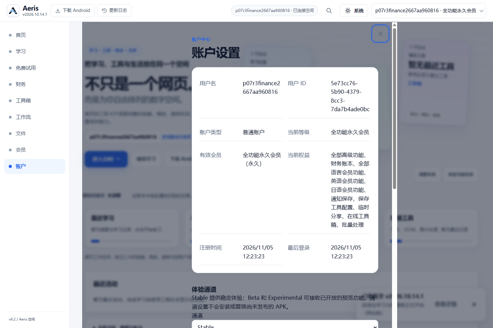 | 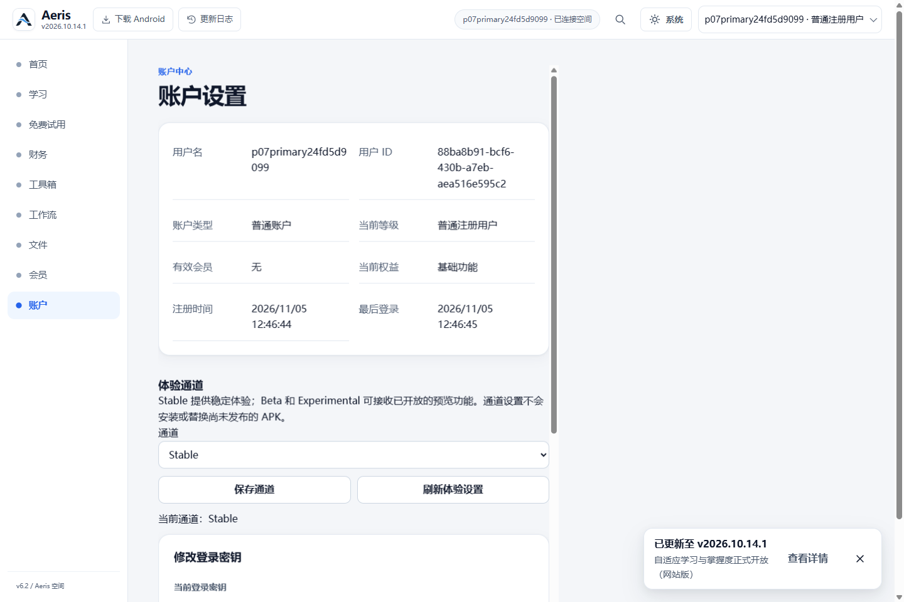 |

### 首页功能卡

先用真实 summary 点击展开 `#homeProductDetails`，再测“功能与账户”的学习、工具箱、财务、分享和账户五卡。每卡记录 9 项：标题、描述、左上/中心/右下表面、内部 CTA、Enter、Space、触摸，共 **45 项**。描述在已展开状态测命中和持续可见；三个表面点在另卡被激活后检查是否真正展开目标。

RED 有 **11 个空白表面点击失败**，真实命中 `ARTICLE.capability-panel` 但目标仍未激活；两个候选均为 **45/45**。例如学习卡中心 `(448.969,606.266)`，新旧命中同一种 ARTICLE，旧版 `active=false`，候选 `active=true`。原版文字/触发按钮能工作，不等于整卡能工作。Enter/Space 还要求 `isTrusted=true,detail=0` 的原生 click，避免 focus 自动展开造成假阳性。[完整坐标矩阵](evidence/round3/candidate/card-hit-matrix.json)

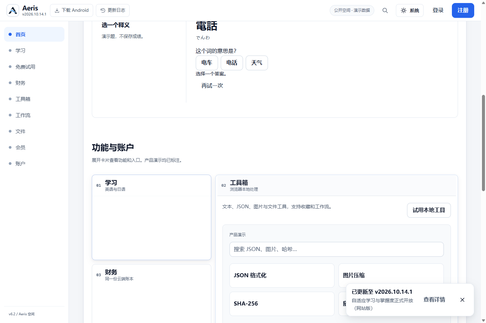

### 英语、日语答题卡与独立视图

相对 `#v3MainCanvas` 测量，未把左侧导航计入居中基准。

| 视口 | RED 卡宽 / 中心偏移 | 候选卡宽 / 中心偏移（两语言一致） |
| --- | --- | --- |
| 1024 | 369.80px / -172.01px | 713.80px / -0.008px |
| 1440 | 487.19px / -174.41px | 836px / 0px |
| 1920 | 487.19px / -174.41px | 836px / 0px |

原 V3 `02-语言学习-沉浸答题.png` 已实际查看，SHA-256 为 `51deae04ed79213a1c7aec31a35b9975cab3ef7c6036c524779f5547ff79d2d4`。原图在双列中放真实题目与反馈；RED 在反馈隐藏时仍预留 `487.188px 324.812px` 两列，右侧为空。候选无反馈时使用居中单列，答题后的反馈有实际正确/释义内容，补测在三宽度检查了其真实尺寸与可见内容。[补测](evidence/round3/candidate/layout-supplement.json)

| RED 英语 | 候选英语 |
| --- | --- |
| 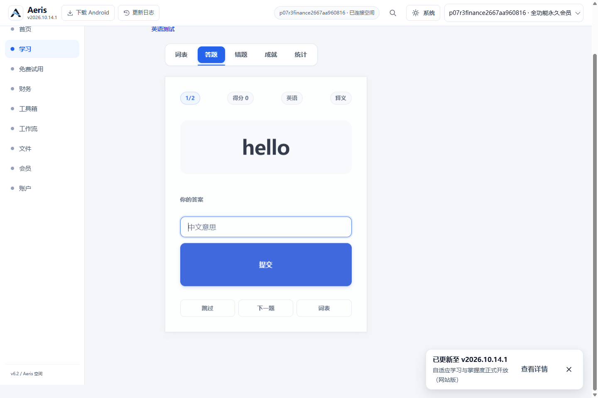 | 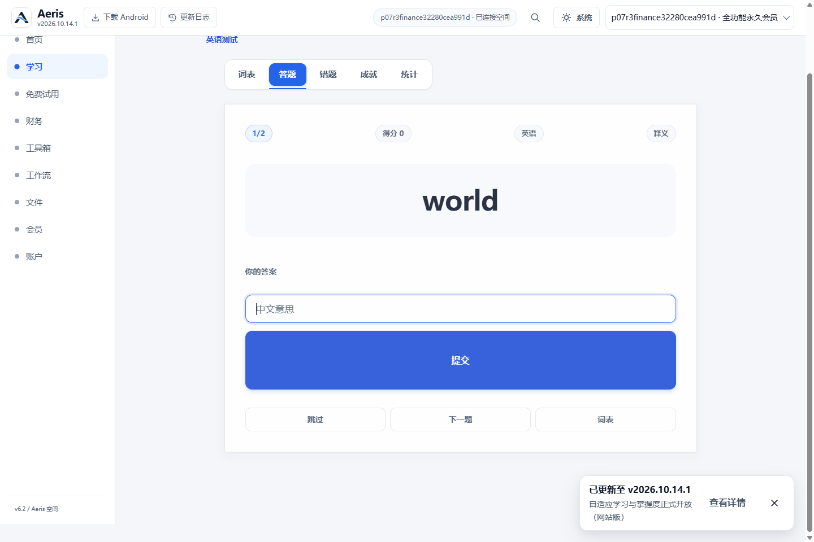 |

词表、答题、错题、成就、统计五视图在两个语言中分别验证。使用现有本地词库的实际答案，完成提交、反馈、下一题、跳过，刷新后保留第三题、得分和错题；切换语言后各自词表及错题不串用。保留原输入式释义合同，没有把设计图的选择题当作已实现业务。

### 英语与日语 AI 调用差异

| 能力 | 实际调用链与结果 | 验收含义 |
| --- | --- | --- |
| 英语常见词释义 | `/api/quiz/start` → `/api/rubric` 返回 `source:'local'` → `/api/judge` 返回 `correct:true,ai_review:false` | 本地词库与规则正常，**不是实际 AI 质量 PASS** |
| 未收录英语释义 | `/api/rubric` 返回 503 `ai_unavailable` | AI OFF 保持失败关闭 |
| 日语假名/写法补全 | 独立 `/api/japanese/readings`；已收录词 200；未收录词 200 且 `ai_unavailable:true`、`unresolved` 非空 | 与释义判题是不同服务，不可因为英语规则正常推断假名 AI 可用 |
| 日语释义 | `/api/rubric` 与 `/api/judge`，使用日语上下文；“電話”本地释义为“电话” | 可独立于 AI 假名补全继续练习 |

Chrome 的 `navigator.webdriver=false`。RED 未收录日语会打开 alert，既有 harness 确认后可继续；`fb936d1` 用 toast 且没有 JS dialog；最新 `f7949f8` 又恢复无条件 alert，实际记录一次必须确认的提示，确认后输入、跳过和返回词表仍可用。这里明确保留“提示会阻断直至确认”的观察，没有把自动确认后的交互 PASS 写成无阻塞通知，也没有把真实 AI 未调用写成 AI PASS。

三个 Hosted Preview 的公开状态均确认 `environment:'preview'`、`ai_ready:false`、`workers_ai:false`、`model:'Cloudflare rules only'`。真实模型质量和假名生成质量均为 **NOT_TESTED/OFF**。

### 财务数值、图表与数据更新

三笔本地真实 D1 测试记录使用 CNY，独立读回交易后的结果为：收入 **1,000,000**，支出 **10,001,000**，余额 **-9,001,000**。对应 minor 值为 `100000000`、`1000100000`、`-900100000`。**所有者原截图的算术正确，本轮没有将其误报为计算错误。**

RED 在 1024px 将大金额断为 2–3 行，1440px 的支出和余额仍断行；纵轴使用 `¥5000500`、`¥10001000`，部分文字 bbox 超出 SVG 左边界。两个候选在 1024/1440/1920 不再断行，纵轴正确分组为 `¥2,500,250` 等，文字未裁切。六个月的实际 SVG 点数和当月收入/支出点值与交易相符。

实际类型筛选得到两笔支出；编辑收入为 2,000,000 后摘要与图表更新；删除 1,000 支出后支出为 10,000,000，图表再次变化；删除剩余合成账目后摘要为零，列表与图表均显示空状态。[实际 CRUD 结果](evidence/round3-latest/round3-browser-results.json)

| RED 金额与刻度 | 最新金额与刻度 |
| --- | --- |
| 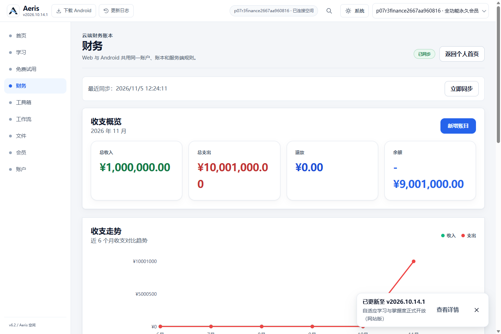 | 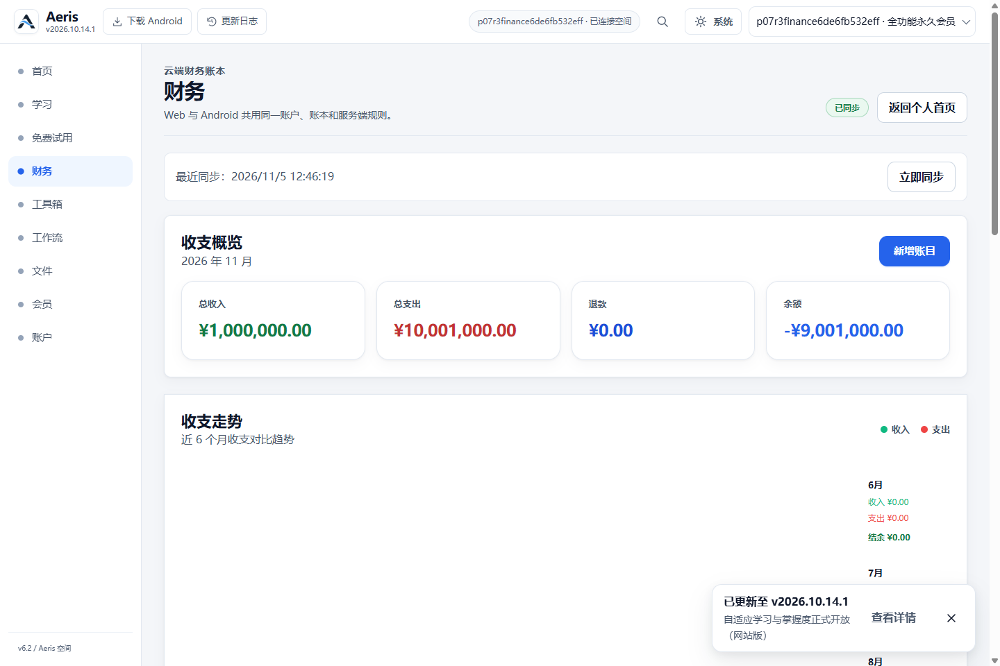 |

P04 六币种依赖 PR #123 没有集成；上述结论只覆盖原 CNY 合同与本次合成交易，不宣称六币种或完整财务发布验收。

## 6. 管理员、会员与账户安全边界

使用原有合法本地 fixture：独立随机 Pepper、Task12 标准密码哈希及本地 D1 super-admin seed。普通合成永久会员与管理员为不同账户，没有绕过服务端鉴权或扩大正式用户权限。

- `/api/admin/users`：匿名 **401**、普通会员 **403**、合法管理员 **200**；普通会员直接打开 `/admin` 不显示后台。
- 本地 8 CNY 合成订单先为 `pending_payment`；提交合成 `user_paid` 提示后，财务 bootstrap 仍 **403**。管理员实际点击审批并确认后，订单 activated、财务 bootstrap **200**；普通会员调用管理员 API 仍 **403**。
- 用户管理、充值申请、审计日志三个后台视图实际可用；审批后有 **5 条**本地审计条目。桌面 1440 与移动 390 均截图，390px `scrollWidth=390`、后台面板宽 362，无横向溢出。
- 合成账户通过账户页面修改密钥：旧 session **401 session_revoked**、旧密钥登录 **403**、新密钥登录 **200**。

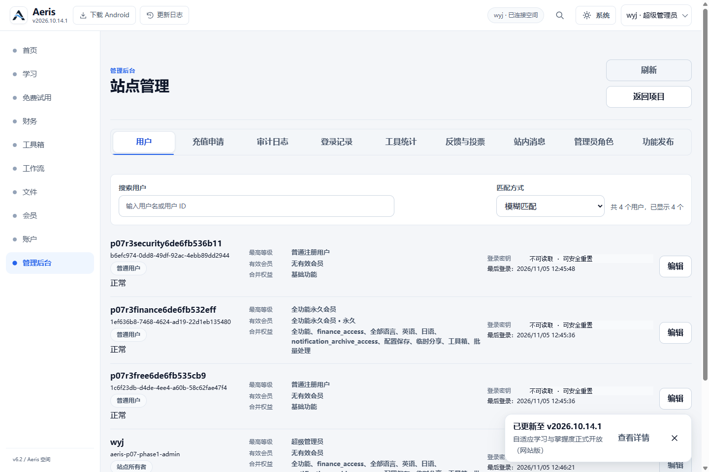

Hosted 管理员、Hosted 登录会员订单、实际支付二维码与实际付款 **未验收**。公开 Preview 状态还有 `r2_binding_missing`、整体 degraded；本地 QR 是专用 1px 合成 PNG，不能外推 Hosted 支付或正式会员业务。没有真实付款。

## 7. Preview、缓存和证据解释

三个不可变 Preview 分别在新的游客浏览器上下文中以 1440/390 检查。每个 Preview 的 `index.html`、`app.js`、`spatial-experience.css`、`js/core/public-experience.js`、`js/finance/app.js` 经 LF 规范化后，与各自固定 Git SHA 的内容一致。只验证这五项选定资源，不冒充完整发布字节证明。所有请求均未登录，任何非 GET/HEAD/OPTIONS API 请求在发网前阻止。[最新只读证据](evidence/round3-latest/hosted-readonly-results.json)

刷新时间线保留了 paint、每帧 DOM、policy 变更、CSS/JS 查询版本、SW controller 和 Cache Storage 名。普通/强制刷新测试是各固定版本内部的暖缓存；同源跨版本升级另有 R3-03 实际浏览器测试。两种缓存证据没有混为同一结论。

## 8. 测试修正与原始失败保留

早期新增驱动遇到 CDP touch 参数 0、关闭的 `homeProductDetails` 中坐标不可见、导航断言读到旧文档、对已移除 splash 取 classList、关闭的财务 disclosure 使 innerText 不适合定位，以及 QR 解码后控件位置变化。均保留原日志与状态，未算成已确认产品缺陷。[修正历史](evidence/round3/driver-development-history.json)

最终修正是等待新的 document identity 和实际 boot、用真实 summary 展开卡片、等待真实 QR 解码后重测命中、用持久数据校验数值并单独断言排版。没有降低 3px 居中阈值、删除业务断言或跳过完整 v2 用例。后补主页面排他测试在三个版本重放，新增真实失败；没有为得到全绿而只确认 URL。

共享证据具有 SHA-256 manifest：[原两版本 manifest](evidence/round3/evidence-manifest.json)、[最新候选 manifest](evidence/round3-latest/evidence-manifest.json)。生成器拒绝覆盖同名但不同字节的证据；一次 OFF 截图命名冲突被拒绝后，改为独立 flag 目录，原文件未被覆盖。

共享文本证据以 LF 字节写入并进入 Git；manifest 可针对 Git blob 或 LF 文本验证，PNG 使用原始字节。Windows checkout 的 CRLF 转换不应被解释为产品内容变化。运行时 driver/source manifest 则记录当次实际读取的文件字节，三版本浏览器脚本哈希一致。

## 9. 复现、交付与保护

完整命令和每项通过标准见 [QA README](../../qa/p07-round3/README.md)。主要新增 `browser.mjs`、`primary-workspaces.mjs`、`cache-upgrade.mjs`、`layout-supplement.mjs`、`preview-readonly.mjs`；扩展现有本地 P07-D runner，保留 source/driver manifest。原 P4 CI 用例仅替换旧账户模态退出假设，其他渲染、列表、权限断言保留。

固定 Windows checkout 的分支仍为 `codex/android-accessibility-accounting-hotfix`，HEAD 仍为 `e2febc6d9a33997bd9dc4cb042ecff216d31fde4`，已观察的 WIP 路径清单与开始时一致；未宣称对全部私人或未跟踪文件做了字节级证明。未写入 Flash 活动树、财务或 Task26 树。Task26 继续 `CLOSED_WITH_OWNER_WAIVER`，豁免未改为 PASS。原根口令文件、签名库和正式凭据未读取。

交付为独立 QA 提交及 Draft PR，包含可重跑门禁、截图、原始 CI 失败摘录及三版本对照。仅推送 QA 分支；不合并、不发布。再次申请人工验收前，应由 Flash 给出修复 R3-01～04 的明确 SHA，再用同一浏览器门禁、主页面排他用例和同源升级用例复测。最新 alert 交互、Hosted 登录/管理员、真实 AI 质量及 owner 既有 profile 的范围继续明确列示，不能用本地合成 PASS 代替。
